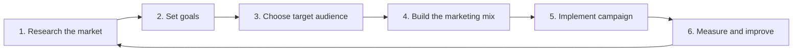
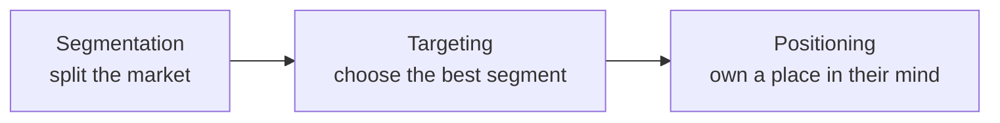

# Session 01: Marketing Basics and Brand Truth

> Module: Foundations of Digital Marketing · Diploma in Digital Marketing · Term 1 · ⏱ ~2 hours

Every digital campaign you will run later (SEO, Google Ads, Instagram, email) is built on classic marketing ideas. In this first session you learn what marketing really is, the steps a marketer follows, the 4Ps and 7Ps, how customers decide, and how a brand finds the one "truth" that makes it different.

## 🎯 Learning Objectives

- Define marketing and explain why every business needs it
- Describe the step-by-step marketing process, from research to review
- Apply the 4Ps and the extended 7Ps of the marketing mix
- Explain the main factors that influence consumer behaviour
- Compare traditional and digital marketing, and list the main types of digital marketing
- Write a Unique Selling Proposition (USP) and explain Segmentation, Targeting and Positioning (STP)

## 📖 Concepts Explained

### 1. What is marketing?

**Marketing** is the work of understanding what people need, creating something valuable for them, telling them about it, and building a relationship so they buy again. Selling is only one part of it.

> **Analogy:** Selling is knocking on doors with a product. Marketing is finding out which street actually wants the product, making it the way they like, and making sure they knock on *your* door.

**Why it matters:** without marketing, even a great product stays unknown. A home baker in Gulshan-e-Iqbal with the best brownies in Karachi will not grow unless people hear about her, trust her and know how to order.

### 2. The marketing process (step by step)

| Step | Question it answers | Small example (a Karachi chai café) |
|---|---|---|
| Research | Who needs what? Who are the competitors? | Students near the university want cheap late-night chai |
| Goals | What do we want to achieve? | 300 orders per week within 3 months |
| Target audience | Who exactly are we serving? | Students aged 18 to 25 within 3 km |
| Marketing mix | What, at what price, where, how promoted? | Karak chai PKR 120, open till 2 am, Instagram reels |
| Implement | Launch the plan | Opening week offer: 2 chai for PKR 200 |
| Measure | Did it work? | Count orders, reviews, followers; adjust |

### 3. The 4Ps of marketing (the marketing mix)

| P | Meaning | Questions to ask |
|---|---|---|
| **Product** | What you sell (goods or service) | What problem does it solve? Features, quality, packaging? |
| **Price** | What the customer pays | Cheaper than rivals or premium? Discounts? Instalments? |
| **Place** | Where and how customers get it | Shop, website, Daraz, foodpanda, home delivery? |
| **Promotion** | How you communicate | Ads, social media, influencers, SMS, billboards? |

### 4. The 7Ps (for services)

Services cannot be touched, so three more Ps are added:

| Extra P | Meaning | Example |
|---|---|---|
| **People** | Staff who deliver the service | Polite riders, helpful call-centre agents |
| **Process** | The steps the customer goes through | Easy 3-step online checkout, quick refund |
| **Physical evidence** | Proof the customer can see | Clean branch, professional website, reviews |

### 5. Consumer behaviour

Consumer behaviour is the study of **how and why people buy**. Four groups of factors affect every decision:

| Factor | Examples |
|---|---|
| Cultural | Religion, festivals (Eid, Ramadan shopping), local values |
| Social | Family, friends, influencers, online reviews |
| Personal | Age, income, job, lifestyle |
| Psychological | Motivation, perception, past experience, beliefs |

Buyers usually move through five decision stages: **need recognition → information search → evaluation of options → purchase → post-purchase feeling**. Digital marketing can help at every stage (for example, Google search during "information search" and a thank-you email after purchase).

### 6. Sales strategies

- **Inbound selling:** attract customers with useful content so they come to you (blogs, YouTube tutorials).
- **Outbound selling:** you reach out first (cold calls, direct messages, flyers).
- **Upselling:** offer a better version ("Upgrade to the 128 GB model for PKR 8,000 more").
- **Cross-selling:** offer a related item ("Add a phone cover?").
- **Consultative selling:** understand the customer's problem first, then recommend.

### 7. Traditional vs digital marketing

| Point | Traditional | Digital |
|---|---|---|
| Channels | TV, radio, newspapers, billboards | Search, social, email, websites, apps |
| Cost to start | High (a TV slot can cost lakhs) | Low (a Facebook ad can start from about PKR 500 a day) |
| Targeting | Broad | Very precise (age, city, interests) |
| Measurement | Hard | Clicks, leads and sales tracked in real time |
| Interaction | One-way | Two-way: comments, DMs, reviews |

### 8. Types of digital marketing

Search Engine Optimization (SEO), Search Engine Marketing (paid search), Social Media Marketing, Content Marketing, Email Marketing, Mobile/SMS Marketing, Affiliate Marketing, Influencer Marketing and Display Advertising. You will study most of these as separate modules this term.

### 9. Unique Selling Proposition (USP)

A **USP** is the one clear reason a customer should choose you over everyone else. A good USP is **specific, believable and important to the customer**.

Simple formula: *We help [audience] get [benefit] through [unique difference].*

> Example: "Hot food at your door in 30 minutes or the delivery is free" (speed guarantee).

### 10. Segmentation, Targeting and Positioning (STP)

- **Segmentation types:** demographic (age, gender, income), geographic (city, area), psychographic (lifestyle, values), behavioural (usage, loyalty).
- **Targeting:** pick the segment that is large enough, reachable and profitable.
- **Positioning / brand positioning:** the image you want customers to hold. A **positioning statement**: *For [target], [brand] is the [category] that [key benefit] because [reason to believe].*

## 💻 Practical Walkthrough

This module is non-coding, so instead of code you will use templates. Copy [`marketing-mix-template.md`](./marketing-mix-template.md) from this folder.

**Walkthrough: 4Ps for a fictional brand "Chai Corner Karachi"**

1. **Product:** Karak chai, doodh patti and parathas; branded paper cups.
2. **Price:** PKR 120 to 250; student card gives 10% off.
3. **Place:** one outlet in North Nazimabad + foodpanda delivery.
4. **Promotion:** Instagram reels of chai being made, WhatsApp Business catalogue.
5. **USP:** "Fresh karak in 5 minutes, open till 2 am."
6. **Positioning statement:** For students and late-night workers in North Karachi, Chai Corner is the café that serves fresh karak chai fast and late, because every cup is brewed to order.

**How it works:** filling each P forces you to think about the full customer offer, not only the advertising.

## 🧪 Lab Practice

1. Pick any Pakistani brand you know (for example a mobile network, a clothing brand or a food chain). Write its 4Ps in a table.
2. Add the 3 extra Ps (People, Process, Physical evidence) for the same brand.
3. List three cultural or social factors that influence people when buying from this brand.
4. Write one USP and one positioning statement using the formulas above.
5. Compare how this brand uses one traditional channel and one digital channel.

## 📝 Assignment

Choose a small local business in your area (bakery, tuition centre, mobile shop). Prepare a one-page marketing snapshot: 7Ps, three customer segments, the chosen target segment, a USP and a positioning statement. Submit as a PDF or Google Doc.

## ❓ Quick Quiz

1. Name the 4Ps of marketing.
2. Which three Ps are added for services?
3. Upselling or cross-selling: "Would you like fries with that?"
4. What does the "T" in STP stand for?
5. Give one advantage of digital marketing over traditional marketing.

Show answers

1. Product, Price, Place, Promotion
2. People, Process, Physical evidence
3. Cross-selling (a related extra item)
4. Targeting
5. Any one: precise targeting, lower starting cost, real-time measurement, two-way interaction

## 💼 Interview Questions

**1. What is the difference between marketing and selling?**

> Selling focuses on converting a buyer now. Marketing is wider: research, product, price, place, promotion and relationship building that make selling easier and repeatable.

**2. How would you explain a USP to a client?**

> It is the single, clear reason a customer should pick them over competitors. It must be specific, true and something customers care about.

**3. Why do marketers segment the market?**

> Because one message cannot fit everyone. Segmenting lets you spend budget on the people most likely to buy and speak to them in their language.

## ✅ Summary

- Marketing = understand needs, create value, communicate it, keep customers.
- The process runs research → goals → audience → mix → launch → measure, then repeats.
- 4Ps cover products; 7Ps add People, Process and Physical evidence for services.
- Consumer decisions are shaped by cultural, social, personal and psychological factors.
- Digital marketing is cheaper to start, more targeted and measurable than traditional.
- A strong brand has a clear USP and uses STP to choose and own its position.

<!-- nav -->

---

[🏠 Module Home](../README.md) · [Next ➡](../Session-02-Practice-Lab-Marketing-Mix-USP-and-STP/README.md)

Prepared by Zeeshan Abbas · Aptech Learning North Nazimabad
