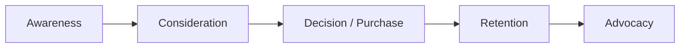

# Session 03: Customer Journey, AIDA and Buyer Personas

> Module: Foundations of Digital Marketing · Diploma in Digital Marketing · Term 1 · ⏱ ~2 hours

Customers rarely buy the first time they see a brand. They notice it, compare, ask friends, think, and only then buy. This session shows you how to map that path (the customer journey), how the AIDA model guides your messages, which digital platforms fit each stage, and how to describe your ideal customer as a buyer persona.

## 🎯 Learning Objectives

- Define the customer journey and explain each of its stages
- Explain the AIDA model and write content for each step
- Match digital marketing platforms to journey stages
- Build a buyer persona from research data
- Identify touchpoints and pain points in a journey

## 📖 Concepts Explained

### 1. What is a customer journey?

The **customer journey** is every step a person takes from first hearing about a brand to buying and (hopefully) recommending it. Each place they meet the brand is a **touchpoint**: an ad, a Google result, a review, a DM reply, the delivery rider.

| Stage | What the customer thinks | What the brand should do | Example touchpoint |
|---|---|---|---|
| Awareness | "I have a problem / need" | Be visible, educate | Instagram reel, YouTube ad, SEO blog |
| Consideration | "Which options are good?" | Compare, prove value | Reviews, comparison post, webinar |
| Decision | "I will buy from this one" | Make buying easy | Clear price, COD, quick WhatsApp reply |
| Retention | "Should I buy again?" | Delight, follow up | Thank-you email, loyalty points |
| Advocacy | "I'll tell my friends" | Reward sharing | Referral code, review request |

> **Analogy:** The journey is like a road trip. Awareness is seeing the signboard, consideration is checking the map and reviews of petrol stations, decision is stopping, retention is coming back on the return trip, and advocacy is telling your cousins which pump had the cleanest washroom.

### 2. The AIDA model

AIDA is a classic model for writing messages that move people to act.

| Letter | Goal | Techniques | Example (an online course) |
|---|---|---|---|
| **A**ttention | Stop the scroll | Bold headline, eye-catching visual, question | "Earn in dollars from Karachi?" |
| **I**nterest | Keep them reading | Facts, story, relevance | "500+ students now freelance on Fiverr" |
| **D**esire | Make them want it | Benefits, testimonials, scarcity | "Ali earned USD 400 in month 2" |
| **A**ction | Tell them what to do | Clear call to action (CTA) | "Register free before Friday: link in bio" |

AIDA and the journey work together: Attention and Interest serve Awareness; Desire serves Consideration; Action serves Decision.

### 3. Digital platforms and where they fit

| Platform | Best for stage | Why |
|---|---|---|
| Google Search / SEO | Consideration, Decision | People actively search with intent |
| Facebook / Instagram | Awareness, Consideration | Huge Pakistani audience, visual |
| TikTok | Awareness | Fast reach with short videos, young audience |
| YouTube | Awareness, Consideration | Tutorials, reviews, long-form trust |
| LinkedIn | B2B awareness and consideration | Professional audience |
| WhatsApp Business | Decision, Retention | Personal chat, catalogue, order updates |
| Email | Retention, Advocacy | Owned channel, low cost |
| Daraz / marketplaces | Decision | Ready buyers, trusted checkout |

### 4. Buyer personas

A **buyer persona** is a short, semi-fictional profile of your ideal customer, based on real data (surveys, interviews, analytics, comments). It turns "our audience" into a person you can picture.

A persona usually includes:

| Section | Example |
|---|---|
| Name and photo | "Sana, 27" (stock photo or icon) |
| Demographics | Lives in Karachi, bank officer, earns PKR 120,000/month |
| Goals | Look professional, save time |
| Pain points | No time to visit malls, worried about fake products online |
| Online behaviour | Instagram 2 hrs/day, shops on Daraz at night, reads reviews |
| Buying triggers | Free delivery, easy returns, Eid sales |
| Preferred channels | Instagram, WhatsApp |
| Quote | "If I can't return it, I won't buy it." |

**Where the data comes from:** customer interviews, Google Forms surveys, social media comments, Google Analytics and Meta audience insights, sales team notes.

### 5. Pain points

A **pain point** is a problem that stops or annoys the customer (slow replies, hidden delivery charges). Mapping pain points on the journey shows exactly where you lose customers.

## 💻 Practical Walkthrough

Use [`persona-template.md`](./persona-template.md) and [`journey-map-template.md`](./journey-map-template.md).

**Walkthrough: a persona for a gym in DHA Lahore**

1. **Collect data:** 10 short member interviews + Instagram comments.
2. **Spot patterns:** most members are 25 to 35, office workers, want to lose weight, can only come after 7 pm.
3. **Write the persona:** "Hamza, 30, software engineer, wants to lose 10 kg, hates crowded gyms, trusts Google reviews."
4. **Map his journey:** sees a transformation reel (Awareness) → checks Google reviews (Consideration) → books a free trial via WhatsApp (Decision) → gets weekly progress messages (Retention) → shares before/after photo for a free month (Advocacy).
5. **Write an AIDA ad for him:** "Crowded gyms? (A) Our DHA studio caps each slot at 15 people (I). Members lose 4 kg in their first 6 weeks (D). Book your free trial on WhatsApp today (A)."

**How it works:** the persona tells you *who*, the journey tells you *where and when*, and AIDA tells you *what to say*.

## 🧪 Lab Practice

1. Choose an online business (food delivery app, e-commerce store, online academy).
2. Create one buyer persona using the template, with at least 8 filled sections.
3. Map the five journey stages for this persona with at least one touchpoint per stage.
4. Mark two pain points on the map and suggest a fix for each.
5. Write one AIDA social media post for the Awareness stage and one for the Decision stage.

## 📝 Assignment

Interview three real people (family or friends) about the last thing they bought online. Use their answers to build one persona and one journey map. Submit both with a short paragraph explaining what surprised you.

## ❓ Quick Quiz

1. List the five stages of the customer journey used in this session.
2. What does the "D" in AIDA stand for?
3. Which platform is strongest for the Decision and Retention stages in Pakistan: TikTok or WhatsApp Business?
4. What is a touchpoint?
5. Name two sources of data for building a persona.

Show answers

1. Awareness, Consideration, Decision, Retention, Advocacy
2. Desire
3. WhatsApp Business
4. Any point where a customer interacts with the brand (ad, website, review, rider, support chat)
5. Any two: interviews, surveys, social comments, analytics, sales team notes

## 💼 Interview Questions

**1. Why are buyer personas useful?**

> They keep the whole team focused on a real customer type, which improves targeting, content, tone and product decisions.

**2. How would you use AIDA in a Facebook ad?**

> Hook with the first line or visual (Attention), give a relevant fact (Interest), show benefits or proof (Desire), and end with one clear CTA button (Action).

**3. What is the difference between the customer journey and the sales funnel?**

> The funnel shows how many people drop off at each step from the company's view. The journey shows the customer's experience, feelings and touchpoints, including after purchase.

## ✅ Summary

- The customer journey: Awareness → Consideration → Decision → Retention → Advocacy.
- AIDA (Attention, Interest, Desire, Action) structures persuasive messages.
- Different platforms are stronger at different journey stages.
- Buyer personas are research-based profiles of ideal customers.
- Mapping touchpoints and pain points shows where to improve.

<!-- nav -->

---

[⬅ Previous](../Session-02-Practice-Lab-Marketing-Mix-USP-and-STP/README.md) · [🏠 Module Home](../README.md) · [Next ➡](../Session-04-Practice-Lab-Journey-Mapping-and-Personas/README.md)

Prepared by Zeeshan Abbas · Aptech Learning North Nazimabad
