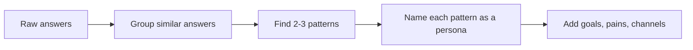

# Session 04: Practice Lab: Journey Mapping and Personas

> Module: Foundations of Digital Marketing · Diploma in Digital Marketing · Term 1 · ⏱ ~2 hours

In this lab you will act like a junior strategist at an agency. The client is a food-delivery home kitchen in Karachi. You will run a quick survey, turn answers into personas, map their journey, and write AIDA messages for each stage. Work in pairs if possible.

## 🎯 Learning Objectives

- Design a short customer research survey in Google Forms
- Analyse survey responses to find patterns
- Build two contrasting buyer personas from data
- Create a full customer journey map with touchpoints, emotions and metrics
- Write stage-specific AIDA copy and choose the right platform for each

## 📖 Concepts Explained

### 1. The client brief

**"Ammi's Kitchen"** (fictional) cooks home-style meals (biryani, qorma, daal chawal) in Gulistan-e-Johar and delivers within 5 km. Meals cost PKR 450 to 900. Orders come only from friends and family via WhatsApp. The owner wants steady weekday lunch orders from offices nearby.

### 2. Good survey questions

| Do | Avoid |
|---|---|
| Ask one thing per question | "Do you like price and taste?" (two things) |
| Use multiple choice for quick analysis | Too many open questions |
| Keep it under 10 questions | 25-question surveys (people quit) |
| Ask about past behaviour ("last week") | Hypotheticals ("would you ever...") |

### 3. From data to persona

A pattern is a group of respondents who share goals and behaviour (for example "office workers who order lunch daily and care about price").

### 4. Emotional curve

On a journey map, draw the customer's mood at each stage (happy, neutral, frustrated). The lowest points are where you will lose customers, so fix those first.

## 💻 Practical Walkthrough

You will reuse templates from Session 03: [persona template](../Session-03-Customer-Journey-AIDA-and-Buyer-Personas/persona-template.md) and [journey map template](../Session-03-Customer-Journey-AIDA-and-Buyer-Personas/journey-map-template.md). Sample survey questions are in [`survey-questions.md`](./survey-questions.md).

**Step 1: Build the survey (15 min)**
1. Open [Google Forms](https://forms.google.com) and create "Lunch Habits Survey".
2. Add the 8 questions from `survey-questions.md`.
3. Turn on "Collect email addresses" only if needed; keep it anonymous otherwise.
4. Share the link with at least 10 classmates or family members.

**Step 2: Analyse (15 min)**
1. Open the **Responses** tab and click **Link to Sheets**.
2. Look at the summary charts. Note the top answers for budget, time and channel.
3. Group respondents into two patterns, for example:
   - Pattern A: office staff, budget PKR 400 to 600, order 3+ times a week, use foodpanda
   - Pattern B: families, order on weekends, value taste and hygiene over price

**Step 3: Personas (20 min)**
- Persona A: "Bilal, 29, accounts officer, wants a filling lunch under PKR 550 by 1:30 pm."
- Persona B: "Nadia, 38, mother of three, wants homemade-quality food for weekend guests."

**Step 4: Journey map for Bilal (25 min)**

| Stage | Touchpoint | Emotion | Fix / message |
|---|---|---|---|
| Awareness | Colleague shares WhatsApp menu | Curious | Shareable menu image with prices |
| Consideration | Checks Instagram for photos and reviews | Unsure (no reviews) | Pin 5 customer reviews |
| Decision | Messages on WhatsApp at 12:30 | Frustrated if no reply | Quick replies + order cut-off 12:00 |
| Retention | Gets lunch on time, tasty | Happy | "Weekly lunch plan: 5 meals PKR 2,500" |
| Advocacy | Asked for review | Proud | Free dessert for each referral |

**Step 5: AIDA copy for each stage (15 min)** - Example for Decision: "Lunch sorted? (A) Fresh daal chawal + salad at your desk by 1 pm (I). Office staff in Johar order 5 days a week (D). WhatsApp 'LUNCH' before 12 noon (A)."

**How it works:** you moved from raw opinions to two clear personas, then to a journey that shows the exact moment you lose orders (the slow WhatsApp reply), and finally to messages that fix it.

## 🧪 Lab Practice

1. Create and share the Google Form; collect at least 10 responses.
2. Export responses to Google Sheets and write 3 findings.
3. Build two personas (one page each).
4. Create a journey map for one persona including an emotional curve.
5. Write five AIDA posts, one per journey stage, and name the platform for each.

## 📝 Assignment

Present your work as a 6-slide deck (Google Slides or PowerPoint): brief, survey findings, two personas, journey map, AIDA messages, top 3 recommendations.

## ❓ Quick Quiz

1. Why should survey questions ask about past behaviour?
2. What is an emotional curve on a journey map?
3. Which stage in the case had the biggest pain point?
4. How many questions should a quick survey ideally have?
5. What is a "pattern" when building personas?

Show answers

1. Past behaviour is more accurate than guesses about the future.
2. A line showing how the customer feels at each stage, revealing frustration points.
3. Decision (slow WhatsApp replies)
4. Under 10
5. A group of respondents who share goals and behaviour

## 💼 Interview Questions

**1. How do you validate a persona?**

> Compare it with real data: analytics audience reports, sales records and more interviews. Update it when the data changes.

**2. A client has no data at all. How do you build personas?**

> Start with short interviews and a survey, read competitor reviews and social comments, then create proto-personas and refine them after the first campaign.

**3. What do you do with a journey map once it is done?**

> Prioritise the worst pain points, assign fixes and owners, and set a metric for each stage to track improvement.

## ✅ Summary

- Research first: short, focused surveys give real data.
- Group answers into patterns; each pattern becomes a persona.
- Journey maps with emotions reveal where customers drop off.
- Write AIDA copy for each stage and match it to the right platform.

<!-- nav -->

---

[⬅ Previous](../Session-03-Customer-Journey-AIDA-and-Buyer-Personas/README.md) · [🏠 Module Home](../README.md) · [Next ➡](../Session-05-Role-of-Digital-Media-in-Marketing/README.md)

Prepared by Zeeshan Abbas · Aptech Learning North Nazimabad
