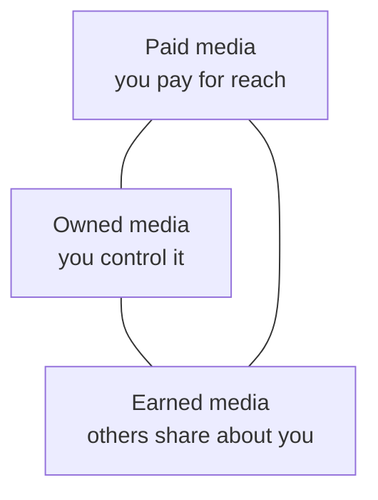

# Session 05: Role of Digital Media in Marketing

> Module: Foundations of Digital Marketing · Diploma in Digital Marketing · Term 1 · ⏱ ~2 hours

Digital media is the "where" of digital marketing: websites, social networks, search engines, videos, podcasts, apps and email. In this session you learn what counts as digital media, the paid-owned-earned model, the main formats, the pros and cons, and the AI trends reshaping the field.

## 🎯 Learning Objectives

- Define digital media and its role in marketing strategy
- Classify media as paid, owned or earned (POEM)
- List the main types and formats of digital media and when to use each
- Evaluate the advantages and disadvantages of digital media
- Describe current AI and digital media trends

## 📖 Concepts Explained

### 1. What is digital media?

**Digital media** is any content that is created, stored and shared in digital form and viewed on a screen: text, images, audio, video and interactive content. In marketing, it is the set of channels a brand uses to reach, engage and convert people online.

### 2. Paid, owned and earned media (POEM)

| Type | Definition | Examples | Strength | Weakness |
|---|---|---|---|---|
| **Paid** | You pay for space or reach | Google Ads, Meta ads, sponsored influencer posts | Fast, scalable, targeted | Stops when money stops |
| **Owned** | Channels you control | Website, blog, email list, app, your social pages | Low cost, long-term asset | Slow to grow |
| **Earned** | Free attention from others | Reviews, shares, news coverage, word of mouth | Most trusted | Hard to control |

A smart plan uses all three: paid ads bring visitors to owned media (website), which delivers a great experience that creates earned media (reviews and shares).

### 3. Types and formats of digital media

| Type | Formats | Best use | Pakistani example |
|---|---|---|---|
| Social media | Posts, reels, stories, lives | Awareness, community | A clothing brand's Instagram reels before Eid |
| Search | Organic results, search ads | Capturing intent | "AC repair Karachi" on Google |
| Video | YouTube videos, shorts, TikTok | Storytelling, tutorials | Cooking channels promoting spice brands |
| Display | Banners on websites and apps | Reach, remarketing | Banners on news websites |
| Email | Newsletters, offers | Retention | Airline or bank e-newsletters |
| Mobile | SMS, push notifications, in-app ads | Instant updates | Telecom bundle SMS offers |
| Audio | Podcasts, music-app ads | Niche audiences | Urdu podcasts with sponsor reads |
| Content | Blogs, e-books, infographics | Education, SEO | A real-estate portal's area guides |

### 4. Pros and cons of digital media

| Pros | Cons |
|---|---|
| Low entry cost; start with a few thousand rupees | Very crowded; hard to stand out |
| Precise targeting by location, age, interests | Ad blockers and "banner blindness" |
| Results measured in real time | Negative comments spread fast |
| Two-way conversation with customers | Platform rules and algorithms change often |
| Easy to test and change campaigns | Privacy laws and data concerns |
| Global reach (exporters, freelancers) | Needs constant fresh content |

### 5. Trends in AI and digital media

- **Generative AI content:** tools like ChatGPT, Gemini and Canva Magic Studio draft captions, images and video scripts (always edit and fact-check).
- **Personalisation at scale:** platforms show different ads and products to each user based on behaviour.
- **Smart bidding and automated campaigns:** Google's Performance Max and Meta's Advantage+ use machine learning to find buyers.
- **Short-form video dominance:** reels, shorts and TikTok drive discovery.
- **Chatbots and conversational commerce:** WhatsApp Business bots taking orders.
- **Voice and visual search:** "Hey Google" queries and Google Lens.
- **Privacy-first marketing:** fewer third-party cookies, more first-party data (email lists, logins).

## 💻 Practical Walkthrough

Use [`poem-audit-template.md`](./poem-audit-template.md).

**Walkthrough: POEM audit of a food chain**

1. Search the brand on Google. Note ads at the top (paid) and its website and Google Business Profile (owned).
2. Open its Instagram, Facebook and TikTok. Record followers, post frequency and formats used (owned).
3. Open the **Meta Ad Library** (https://www.facebook.com/ads/library), select Pakistan, search the brand and count active ads (paid).
4. Read Google Maps reviews and search "brand name review" on YouTube (earned).
5. Fill the audit table and give a score from 1 to 5 for each media type.
6. Write two recommendations, for example "strong paid, weak earned: start a review request after each delivery."

**How it works:** a POEM audit quickly shows which media a brand relies on and which it neglects, guiding where the next rupee should go.

## 🧪 Lab Practice

1. Make a list of 10 digital media touchpoints you saw today and label each as paid, owned or earned.
2. Complete a POEM audit for one Pakistani brand using the template.
3. Find two active ads of that brand in the Meta Ad Library and note their format and CTA.
4. List three pros and three cons of digital media for that specific brand.
5. Use any free AI tool to draft three captions for the brand; edit them and note what you changed and why.

## 📝 Assignment

Write a 500-word report: "How AI is changing digital media in Pakistan", with at least three real examples (brands, tools or campaigns) and one risk.

## ❓ Quick Quiz

1. A customer posts a positive review on Google Maps. Paid, owned or earned?
2. Name two owned media channels.
3. Give one disadvantage of digital media.
4. What tool lets you see the active ads of any Facebook page?
5. Name one AI trend in digital media.

Show answers

1. Earned
2. Any two: website, blog, email list, app, brand social pages
3. Any one: crowded market, ad blockers, fast negative spread, algorithm changes, privacy rules
4. Meta Ad Library
5. Any one: generative AI content, personalisation, smart bidding, chatbots, voice search

## 💼 Interview Questions

**1. Explain paid, owned and earned media with one example each.**

> Paid: a sponsored Instagram post. Owned: the brand's website. Earned: a customer's unboxing video shared on TikTok.

**2. Why should a brand invest in owned media if paid ads work?**

> Paid reach stops when spending stops. Owned media (email lists, website, SEO) keeps working and lowers long-term cost per customer.

**3. How should marketers use generative AI responsibly?**

> Use it for drafts and ideas, then check facts, keep the brand voice, avoid copyrighted material and disclose AI use where required.

## ✅ Summary

- Digital media = screen-based content and channels used to reach customers.
- POEM: paid (rent reach), owned (build assets), earned (gain trust).
- Each format has a best use: search for intent, social for awareness, email for retention.
- Digital media is cheap, targeted and measurable, but crowded and fast-changing.
- AI is driving personalisation, automation and new content formats.

<!-- nav -->

---

[⬅ Previous](../Session-04-Practice-Lab-Journey-Mapping-and-Personas/README.md) · [🏠 Module Home](../README.md) · [Next ➡](../Session-06-Practice-Lab-Digital-Media-Mix-Plan/README.md)

Prepared by Zeeshan Abbas · Aptech Learning North Nazimabad
