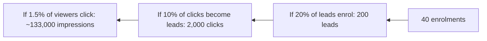

# Session 06: Practice Lab: Digital Media Mix Plan

> Module: Foundations of Digital Marketing · Diploma in Digital Marketing · Term 1 · ⏱ ~2 hours

Knowing the channels is not enough; a marketer must decide **which** channels to use, **how much** money each gets and **what** content goes on each. In this lab you will build a one-month digital media mix plan with a real PKR budget for a small Pakistani business.

## 🎯 Learning Objectives

- Translate business goals into channel choices
- Split a fixed budget across paid, owned and earned activities
- Choose content formats that suit each platform
- Estimate reach and results with simple calculations
- Present a media plan in a clear table

## 📖 Concepts Explained

### 1. The client brief

**"Skill Up Academy"** (fictional) in North Nazimabad, Karachi, runs a 3-month Graphic Design course (fee PKR 30,000). Goal: **40 enrolments** for the January batch. Monthly marketing budget: **PKR 60,000**.

### 2. Working backwards from the goal

Marketers work backwards: enrolments ← leads ← clicks ← impressions.

These rates are **assumptions**; you will improve them with real data after launch.

### 3. Key planning terms

| Term | Meaning | Simple formula |
|---|---|---|
| Impressions | Times an ad/post is shown | - |
| CTR (Click-Through Rate) | % of viewers who click | clicks ÷ impressions × 100 |
| CPC (Cost Per Click) | Cost of one click | spend ÷ clicks |
| CPL (Cost Per Lead) | Cost of one enquiry | spend ÷ leads |
| CPA (Cost Per Acquisition) | Cost of one customer | spend ÷ customers |
| Conversion rate | % who take the desired action | conversions ÷ visitors × 100 |

### 4. The 70-20-10 budget idea

A practical split for small budgets:
- **70%** on proven channels (what already works or is most likely to)
- **20%** on promising channels (growing, partly tested)
- **10%** on experiments (new format or platform)

### 5. Content per platform

| Platform | Format that works | Frequency (small brand) |
|---|---|---|
| Instagram | Reels of student work, carousels with tips | 4 reels + 3 posts per week |
| Facebook | Lead ads, community group posts | Ads daily, 3 posts per week |
| TikTok | 15 to 30 second "before/after design" videos | 3 to 5 per week |
| Google Search | Search ads on "graphic design course Karachi" | Always on |
| WhatsApp | Broadcast to leads, brochures, reminders | 1 to 2 per week |
| Google Business Profile | Photos, posts, reviews | Weekly |

## 💻 Practical Walkthrough

Use the planning sheet [`media-plan.csv`](./media-plan.csv). Open it in Excel or Google Sheets.

**Step 1: Allocate the budget (PKR 60,000)**

| Channel | Type | Budget (PKR) | Share |
|---|---|---|---|
| Meta lead ads (FB + IG) | Paid | 30,000 | 50% |
| Google search ads | Paid | 12,000 | 20% |
| TikTok boost (experiment) | Paid | 6,000 | 10% |
| Reels and design content (freelance editor) | Owned | 8,000 | 13% |
| Review and referral rewards | Earned | 4,000 | 7% |

**Step 2: Estimate results** - if Meta CPL is about PKR 200, then PKR 30,000 ÷ 200 = **150 leads**. If Google CPC is about PKR 40 and 8% of clicks become leads: 12,000 ÷ 40 = 300 clicks × 8% = **24 leads**. Total paid leads ≈ 174 + TikTok and organic.

**Step 3: Content plan** - write 4 weekly themes: Week 1 "Student success stories", Week 2 "Free design tips", Week 3 "Meet the trainer", Week 4 "Last seats + fee offer".

**Step 4: Measurement** - decide the metric and tool per channel (Meta Ads Manager: CPL; Google Ads: CPC, conversions; GA4: website visits; WhatsApp labels: enquiries and enrolments).

**How it works:** working backwards from 40 enrolments gives the lead target; the budget split and cost estimates show whether the plan can reach it. If it cannot, you either increase budget, improve conversion, or lower the goal.

## 🧪 Lab Practice

1. Open `media-plan.csv` and recreate the budget table with your own split (must total PKR 60,000).
2. Using the funnel rates above, calculate how many impressions and clicks you need for 40 enrolments.
3. Fill the content plan columns with one content idea per channel per week.
4. Add a "KPI" column and a "tool" column for each channel.
5. Change one assumption (for example lead-to-enrolment rate from 20% to 15%) and recalculate. Note what changes.

## 📝 Assignment

Create a complete one-month media plan for a different business (choose: a bakery in Hyderabad with PKR 25,000, or a real-estate agent in Islamabad with PKR 150,000). Include the goal, funnel calculation, budget split, content calendar and KPIs.

## ❓ Quick Quiz

1. Spend PKR 10,000, get 50 leads. What is the CPL?
2. 20,000 impressions and 300 clicks. What is the CTR?
3. In 70-20-10, what is the 10% for?
4. Why do planners work backwards from the goal?
5. Which tool shows Meta ad cost per lead?

Show answers

1. PKR 200
2. 1.5%
3. Experiments with new channels or formats
4. To calculate how many leads, clicks and impressions are needed and check the budget is realistic
5. Meta Ads Manager

## 💼 Interview Questions

**1. How would you plan a campaign with a small budget?**

> Start from the business goal, pick 1 to 2 channels where the audience already is, set CPL/CPA targets, test small, then move money to what performs.

**2. What is the difference between CPC and CPA?**

> CPC is the cost of one click. CPA is the cost of one completed goal (a sale or sign-up), which matters more to the business.

**3. How do you know if a media plan is working after week one?**

> Compare actual CTR, CPC and CPL against the planned assumptions, and shift budget from weak channels to strong ones.

## ✅ Summary

- Media plans start from a business goal and work backwards through the funnel.
- Budget is split across paid, owned and earned activities (70-20-10 helps).
- Each platform needs its own content format and frequency.
- CTR, CPC, CPL and CPA turn a plan into measurable targets.
- Assumptions are updated with real data every week.

<!-- nav -->

---

[⬅ Previous](../Session-05-Role-of-Digital-Media-in-Marketing/README.md) · [🏠 Module Home](../README.md) · [Next ➡](../Session-07-Presentation-Skills-and-Website-Basics/README.md)

Prepared by Zeeshan Abbas · Aptech Learning North Nazimabad
