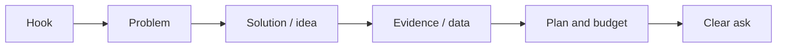

# Session 07: Presentation Skills and Website Basics

> Module: Foundations of Digital Marketing · Diploma in Digital Marketing · Term 1 · ⏱ ~2 hours

A digital marketer spends half the time doing the work and half the time explaining it: pitching ideas to clients, presenting reports to managers. And almost every campaign sends people to a website. This session covers both skills: presenting clearly, and understanding (and building) a simple business website with WordPress.

## 🎯 Learning Objectives

- Explain why presentation skills matter for marketers
- Structure a persuasive presentation and design clean slides
- Explain why a website is the centre of digital marketing
- Identify the essential pages and elements of a business website
- Describe domain, hosting and CMS, and create a basic WordPress site

## 📖 Concepts Explained

### 1. Why presentations matter

Marketers present campaign ideas to clients, monthly results to managers and strategies to teams. A good idea presented badly is often rejected. A clear presentation builds trust, wins budgets and gets decisions made faster.

### 2. Structure of a persuasive presentation

| Part | What to include | Example |
|---|---|---|
| Hook | A surprising fact or question | "68% of your website visitors leave in 5 seconds." |
| Problem | The client's pain in their words | "Enquiries dropped 30% since March." |
| Solution | Your idea in one sentence | "A landing page + Google search ads for 'AC service Karachi'." |
| Evidence | Data, examples, case studies | Competitor screenshot, keyword volumes |
| Plan | Timeline, budget, KPIs | 4 weeks, PKR 80,000, target 120 leads |
| Ask | What you want them to decide | "Approve the budget by Friday." |

### 3. Slide design rules

- **One idea per slide**, headline as a full sentence ("Instagram drives 60% of our leads").
- Maximum about **6 lines** of text; use visuals and charts instead of paragraphs.
- Use **2 brand colours + 1 accent**, one font family, large font (24 pt+).
- Show numbers as charts; highlight the key number.
- **10-20-30 guideline:** about 10 slides, 20 minutes, 30-point font.

### 4. Delivery tips

Practise out loud twice; know your first and last sentence by heart; look at people, not the screen; pause after key numbers; prepare answers for likely questions (budget, timeline, risks); end on time.

### 5. Why websites matter in digital marketing

A website is your **owned media home base**. Social platforms can change rules or block accounts; your website stays yours.

| Role | Why it matters |
|---|---|
| Credibility | Customers check the website before trusting a business |
| Conversion | Forms, checkout, WhatsApp buttons turn visitors into leads |
| SEO | Google can rank your pages for free traffic |
| Tracking | GA4 and pixels measure every campaign |
| Landing pages | Ads need a focused page to send people to |

### 6. Essential website elements

- **Pages:** Home, About, Services/Products, Contact, Blog (optional), Privacy Policy.
- **Elements:** clear headline, call-to-action buttons, contact details, WhatsApp click-to-chat, testimonials, mobile-friendly design, fast loading, SSL (https).

### 7. Domain, hosting and CMS

| Term | Meaning | Analogy |
|---|---|---|
| Domain | Your address, e.g. `skillupacademy.pk` | House address |
| Hosting | Server space where files live | The plot of land |
| CMS | Software to manage content without coding | Furniture and rooms you can rearrange |

`.pk` domains are registered through PKNIC-accredited resellers; `.com` through any registrar. **WordPress** powers a large share of websites worldwide and is free. Two options: **WordPress.com** (hosted for you, easiest to start) and **WordPress.org** software (self-hosted on your own hosting, full control).

## 💻 Practical Walkthrough

**Part A: Build a basic WordPress site (free WordPress.com plan)**

1. Go to [wordpress.com](https://wordpress.com) and click **Get started**. Sign up with your email.
2. Choose a free address like `chaicornerkhi.wordpress.com` (skip paid domains for practice).
3. Pick the **Free** plan. When asked for goals, choose "Promote myself or business".
4. Choose a simple theme (for example a business or restaurant theme).
5. In the dashboard open **Pages → Add New** and create: Home, About, Menu/Services, Contact.
6. On the Home page, use the block editor: add a **Heading** ("Fresh karak chai, open till 2 am"), a **Paragraph**, an **Image**, and a **Buttons** block ("Order on WhatsApp").
7. For the button link, use a WhatsApp click-to-chat link: `https://wa.me/923001234567` (replace with a real number in international format, no plus sign or dashes).
8. On the Contact page add the **Contact Form** block, address and opening hours.
9. Go to **Appearance → Site Editor** (or Customize) to set colours and the site logo.
10. Set Home as the front page: **Settings → Reading → A static page → Home**. Click **Publish / Launch**.

**Part B: Present the site** - make a 5-slide deck using [`pitch-outline.md`](./pitch-outline.md): hook, problem, website tour, next steps, ask.

**How it works:** the CMS lets you create pages with blocks, no coding needed. The WhatsApp button turns a visitor into a conversation, which is how many Pakistani small businesses actually close sales.

## 🧪 Lab Practice

1. Create a free WordPress.com site for a fictional local business.
2. Add four pages and a navigation menu.
3. Add a WhatsApp CTA button and a contact form.
4. Make sure the site looks good on mobile (use the preview mobile icon).
5. Prepare and deliver a 3-minute presentation of your site to a classmate using the pitch outline.

## 📝 Assignment

Finish your WordPress site with at least one blog post (300 words) about the business, and record a 3-minute screen-recorded presentation pitching the site to the "owner".

## ❓ Quick Quiz

1. What is the difference between a domain and hosting?
2. Name four essential pages of a business website.
3. What does the 10-20-30 guideline stand for?
4. What is the format of a WhatsApp click-to-chat link?
5. Why is a website called "owned media"?

Show answers

1. Domain is the address; hosting is the server space where the site files are stored.
2. Home, About, Services/Products, Contact (also Privacy Policy, Blog)
3. About 10 slides, 20 minutes, 30-point minimum font
4. `https://wa.me/<countrycode><number>`, for example `https://wa.me/923001234567`
5. The business controls it fully, unlike rented reach on platforms.

## 💼 Interview Questions

**1. How do you present bad campaign results to a client?**

> Be honest and early, show the data, explain the likely reasons, and present a clear fix with a timeline. Focus on what you learned.

**2. Why would you recommend WordPress to a small business?**

> It is free, has thousands of themes and plugins (SEO, forms, e-commerce), is easy for staff to update, and is widely supported by developers.

**3. What makes a good landing page?**

> One goal, a clear headline matching the ad, benefits, proof (reviews), a visible CTA, fast loading and mobile-friendly design.

## ✅ Summary

- Presentations win budgets: hook, problem, solution, evidence, plan, ask.
- Clean slides: one idea each, few words, big fonts, charts over tables.
- A website is the owned home base for credibility, conversion, SEO and tracking.
- Domain = address, hosting = server, CMS = easy content management.
- WordPress lets you build a business site with blocks and no code.

<!-- nav -->

---

[⬅ Previous](../Session-06-Practice-Lab-Digital-Media-Mix-Plan/README.md) · [🏠 Module Home](../README.md) · [Next ➡](../Session-08-Practice-Lab-WordPress-Site-and-Client-Pitch/README.md)

Prepared by Zeeshan Abbas · Aptech Learning North Nazimabad
