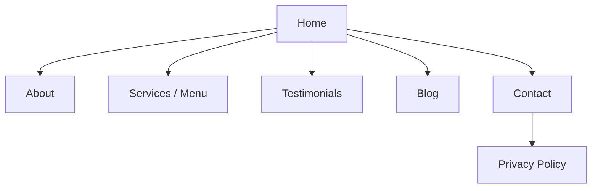

# Session 08: Practice Lab: WordPress Site and Client Pitch

> Module: Foundations of Digital Marketing · Diploma in Digital Marketing · Term 1 · ⏱ ~2 hours

This final lab of the module brings everything together. You will take a business, apply the marketing foundations (7Ps, USP, persona, journey), turn them into a marketing-ready WordPress website, check it with a quality checklist, and pitch it in five minutes.

## 🎯 Learning Objectives

- Convert a USP and persona into website copy
- Plan a site map and page-by-page content
- Add conversion elements (CTAs, forms, WhatsApp, testimonials)
- Audit a website with a marketing checklist
- Deliver a structured five-minute client pitch

## 📖 Concepts Explained

### 1. From strategy to website copy

| Strategy item | Where it appears on the site |
|---|---|
| USP | Home page headline (hero section) |
| Persona pain points | "Why choose us" section |
| Physical evidence (7Ps) | Testimonials, photos, certificates |
| Process (7Ps) | "How it works in 3 steps" section |
| Decision-stage needs (journey) | Prices, FAQs, CTA buttons, WhatsApp |
| Retention | Newsletter sign-up, loyalty info |

### 2. A simple site map

### 3. Home page section order (proven pattern)

1. **Hero:** USP headline + one-line explanation + main CTA button
2. **Benefits:** three short benefit blocks with icons
3. **How it works:** 3 steps
4. **Social proof:** testimonials, ratings, client logos
5. **Offer / pricing:** clear PKR prices or starting price
6. **FAQ:** answers the top objections
7. **Final CTA:** repeat the main button
8. **Footer:** address, phone, map, social links

### 4. Writing web copy

- Write for one persona; use "you" more than "we".
- Lead with benefits, then features ("Fresh meals at your desk by 1 pm" before "We use a 5-step hygiene process").
- Short sentences and paragraphs; scannable headings.
- Every page should have one clear next step.

## 💻 Practical Walkthrough

Use the checklist [`website-launch-checklist.md`](./website-launch-checklist.md). Continue with the WordPress site from Session 07 or create a new one.

**Step 1: Plan (15 min)** - write the site map and one sentence of purpose for each page.

**Step 2: Hero section (15 min)**
1. Edit Home. Add a **Cover** block with a background image.
2. Inside it add a Heading (your USP), a Paragraph and a **Buttons** block.
3. Link the button to WhatsApp (`https://wa.me/92XXXXXXXXXX`) or the Contact page.

**Step 3: Benefits and process (15 min)** - add a **Columns** block (3 columns), each with an icon/image, a short heading and one line. Then add "How it works" with three numbered steps.

**Step 4: Social proof and FAQ (15 min)** - add a **Quote** block per testimonial (use realistic sample names, mark them as samples while practising) and a **Details** block for each FAQ (it creates an expandable question).

**Step 5: SEO basics (10 min)** - in each page's settings write a clear title, use one H1 per page, add alt text to images, and set a readable permalink (Settings → Permalinks → Post name, available on self-hosted or upgraded plans).

**Step 6: Audit (10 min)** - go through the checklist on desktop and mobile. Fix at least three issues.

**Step 7: Pitch (5 min per student)** - present: business and persona → USP → site tour (hero, proof, CTA) → what you would track → next steps.

**How it works:** each block on the page answers a question the persona has at the decision stage. The checklist catches common mistakes that cost leads (broken buttons, no phone number, slow images).

## 🧪 Lab Practice

1. Draw the site map for your business.
2. Build the full home page with all eight sections.
3. Write three FAQs that answer real objections from your persona.
4. Complete the launch checklist and record a score out of 20.
5. Pitch to a partner and collect two pieces of feedback.

## 📝 Assignment

**Module mini-deliverable:** submit your site link, your completed checklist, and a 6 to 8 slide pitch deck covering 7Ps, persona, journey, USP, website and next steps.

## ❓ Quick Quiz

1. Where should the USP appear on the website?
2. Which WordPress block creates an expandable FAQ?
3. Why use "you" more than "we" in web copy?
4. Name two kinds of social proof.
5. What is the purpose of the final CTA section?

Show answers

1. In the home page hero headline
2. The Details block
3. It focuses on the customer's needs and benefits, which persuades better
4. Any two: testimonials, ratings, reviews, client logos, case studies, follower counts
5. To give visitors who scrolled the whole page an easy next step

## 💼 Interview Questions

**1. What would you check first on a client's website before running ads?**

> Mobile view, loading speed, a clear CTA, working forms/WhatsApp links, and tracking (GA4 and ad pixels) installed.

**2. How do you turn a persona into website content?**

> Use their goals in headlines, their pain points in benefit sections, their objections in FAQs, and their preferred contact channel as the CTA.

**3. What is a hero section?**

> The first screen of a page: headline, short subheading, main visual and primary CTA. It must explain the offer in a few seconds.

## ✅ Summary

- Strategy (7Ps, USP, persona, journey) becomes website structure and copy.
- A proven home page order: hero, benefits, process, proof, offer, FAQ, CTA, footer.
- Write benefit-first, scannable, persona-focused copy.
- Audit every site with a checklist before launch.
- Pitch your work with a clear structure and a confident ask.

<!-- nav -->

---

[⬅ Previous](../Session-07-Presentation-Skills-and-Website-Basics/README.md) · [🏠 Module Home](../README.md)

Prepared by Zeeshan Abbas · Aptech Learning North Nazimabad
