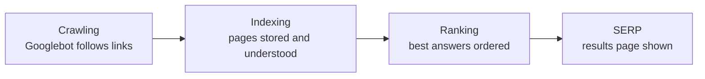

# Session 01: Search Engines, On-Page, Off-Page and Mobile SEO

> Module: Introduction to SEO · Diploma in Digital Marketing · Term 1 · ⏱ ~2 hours

When someone in Karachi types "best laptop under 150000" into Google, a few websites get almost all the clicks. Search Engine Optimization (SEO) is the skill of earning those top positions without paying for each click. This session explains how search engines work, the basics of SEO, advanced Google search tricks, on-page and off-page optimisation, mobile SEO, SEO-friendly and local content.

## 🎯 Learning Objectives

- Describe the components of a search engine and how it crawls, indexes and ranks pages
- Define SEO and its main techniques and types
- Use Google search operators and settings for research
- Apply on-page SEO: keywords, titles, meta descriptions, headings, content and site structure
- Explain off-page SEO: backlinks, brand mentions and social signals
- Explain mobile SEO, responsive design and local SEO content

## 📖 Concepts Explained

### 1. How a search engine works



| Component | What it does | Analogy |
|---|---|---|
| **Crawler** (spider, e.g. Googlebot) | Visits pages and follows links to discover new ones | A librarian walking the city collecting books |
| **Index** | A huge database of pages and what they are about | The library catalogue |
| **Ranking algorithm** | Decides which pages best answer a query, using hundreds of signals | The librarian recommending the best three books |
| **SERP** | Search Engine Results Page: ads, organic results, maps, videos, "People also ask" | The shelf of recommendations |

Main ranking themes: **relevance** (does the page match the query?), **quality and trust** (helpful, accurate content; often summarised as E-E-A-T: Experience, Expertise, Authoritativeness, Trustworthiness), **usability** (mobile-friendly, fast, secure), and **context** (searcher's location, language, device).

### 2. What is SEO?

**SEO** is improving a website so search engines understand it and rank it higher for relevant searches, bringing free (organic) traffic.

| Type | Focus | Examples |
|---|---|---|
| On-page SEO | Content and HTML of your pages | Keywords, titles, headings, images |
| Off-page SEO | Signals from outside your site | Backlinks, reviews, mentions |
| Technical SEO | How well the site can be crawled and loaded | Speed, sitemap, HTTPS, mobile (Session 03) |
| Local SEO | Visibility in map and "near me" searches | Google Business Profile |

**White-hat** SEO follows search engine guidelines. **Black-hat** tricks (keyword stuffing, buying spam links, hidden text) can get a site penalised.

### 3. Google search settings and operators

| Operator | Example | Result |
|---|---|---|
| `"..."` | `"digital marketing course karachi"` | Exact phrase |
| `-` | `jaguar -car` | Exclude a word |
| `site:` | `site:daraz.pk headphones` | Results only from one site |
| `intitle:` | `intitle:seo checklist` | Word must be in the page title |
| `filetype:` | `filetype:pdf marketing plan` | Specific file type |
| `OR` | `biryani OR pulao recipe` | Either term |

`site:yourdomain.com` is a quick way to see roughly how many of your pages Google has indexed. In **Settings** you can set language and region, SafeSearch and results filters; under **Tools** you can filter by time (past week, past year), which is handy for fresh research.

### 4. On-page optimisation

**Keyword research** finds the words people actually type. Look at search volume, competition and **search intent**:

| Intent | Example query | Best page type |
|---|---|---|
| Informational | "what is seo" | Blog/guide |
| Navigational | "daraz login" | Brand page |
| Commercial | "best phones under 50000" | Comparison/review |
| Transactional | "buy iphone 15 karachi" | Product/category page |

**Short-tail** keywords ("shoes") are broad and competitive; **long-tail** ("men's running shoes size 9 lahore") are specific, easier to rank and convert better.

**On-page elements:**

| Element | Best practice |
|---|---|
| Title tag | Unique, about 50-60 characters, main keyword near the start, brand at end |
| Meta description | About 150-160 characters, benefit + CTA (not a ranking factor, but drives clicks) |
| URL | Short, readable, hyphens: `/seo-course-karachi` |
| H1 | One per page, describes the topic |
| H2/H3 | Logical sub-sections with related keywords |
| Content | Answers the query fully, original, easy to read |
| Images | Descriptive file names, alt text, compressed |
| Internal links | Link related pages with descriptive anchor text |

**Site structure:** organise pages like a tree (Home → Category → Sub-category → Page) so users and crawlers find everything within about three clicks.

### 5. Off-page optimisation

**Backlinks** are links from other websites to yours; Google treats quality links as votes of trust. One link from a respected news site or university is worth more than hundreds from spammy directories.

Ways to earn good links: publish useful research or guides, guest posts on relevant blogs, local business directories and chambers of commerce, digital PR (a story journalists want), partnerships and sponsorships, and fixing broken links on other sites by suggesting your page. **Social media** does not pass ranking power directly, but it spreads content so more people see and link to it, and builds brand searches.

### 6. Mobile SEO

Google uses **mobile-first indexing**: it mainly looks at the mobile version of your site. Most Pakistani users browse on phones.

Key factors: **responsive design** (one site that adapts to screen size), fast loading on 4G, readable fonts without zooming, tap targets spaced apart, no intrusive pop-ups, and the viewport meta tag. A separate **mobile sitemap** is only needed for old feature-phone pages; responsive sites use a normal XML sitemap.

### 7. SEO-friendly and local content

- Write for people first; answer the question early; use headings, lists, short paragraphs.
- Cover the topic fully (related questions from "People also ask").
- Update old content; add dates, facts and examples.
- **Local SEO:** create and verify a **Google Business Profile**, keep name/address/phone (NAP) identical everywhere, collect reviews, add area names naturally ("AC repair in Gulshan-e-Iqbal").
- Widely used platforms to share content: Facebook, Instagram, YouTube, TikTok, LinkedIn, X and Pinterest.

## 💻 Code Examples

### Example 1: SEO meta tags in the page head (`meta-tags.html`)

```html
<!DOCTYPE html>
<html lang="en">
<head>
  <!-- 1. Character set and mobile viewport (needed for mobile SEO) -->
  <meta charset="UTF-8">
  <meta name="viewport" content="width=device-width, initial-scale=1">

  <!-- 2. Title tag: main keyword first, brand last (about 50-60 characters) -->
  <title>Digital Marketing Course in Karachi | Skill Up Academy</title>

  <!-- 3. Meta description: benefit + call to action (about 150-160 characters) -->
  <meta name="description" content="Learn SEO, Google Ads and social media in 3 months. Weekend classes in North Nazimabad, Karachi. Book a free demo class today.">

  <!-- 4. Canonical: tells Google the main URL of this page -->
  <link rel="canonical" href="https://www.example.com/digital-marketing-course-karachi">
</head>
<body>
  <!-- 5. One H1 that matches the page topic -->
  <h1>Digital Marketing Course in Karachi</h1>
  <h2>What you will learn</h2>
  <p>SEO, Google Ads, social media and analytics with real projects.</p>

  <!-- 6. Image with a descriptive alt text -->
  

  <!-- 7. Internal link with descriptive anchor text -->
  <a href="/course-fee-and-schedule">See course fee and schedule</a>
</body>
</html>
```

**How it works:** the title and description control how the page looks in Google results; the viewport tag makes it mobile-friendly; the canonical prevents duplicate-URL confusion; the H1, alt text and anchor text tell Google what the page is about.

### Example 2: A basic `robots.txt`

```text
# Allow all crawlers to visit the site
User-agent: *
# Keep private or useless pages out of crawling
Disallow: /admin/
Disallow: /cart/
# Tell crawlers where the sitemap is
Sitemap: https://www.example.com/sitemap.xml
```

**How it works:** `robots.txt` sits at the root of the domain (`example.com/robots.txt`) and tells crawlers which paths not to crawl. It is not a security tool, and blocking a page here does not guarantee it will not appear in search; use a `noindex` meta tag for that.

## 🧪 Lab Practice

1. Search `site:` for any Pakistani e-commerce site and note how many results appear.
2. Use three operators (`"..."`, `-`, `intitle:`) to research "digital marketing jobs" and record what changes.
3. Pick a local business website; write down its title tag and meta description (right-click → View Page Source). Rewrite both better.
4. Open `meta-tags.html` in a browser and in VS Code; change the title and description to suit your own business idea.
5. Find two websites that could realistically link to a Karachi bakery and explain why.

## 📝 Assignment

Write an on-page SEO plan for one page of a local business: target keyword, intent, title tag, meta description, URL, H1, three H2s, two image alt texts and two internal links.

## ❓ Quick Quiz

1. Put in order: indexing, crawling, ranking.
2. What does `site:daraz.pk` do?
3. Is a meta description a direct ranking factor?
4. What is a backlink?
5. What does mobile-first indexing mean?

<details>
<summary>Show answers</summary>

1. Crawling → indexing → ranking
2. Shows results only from daraz.pk
3. No, but a good one increases click-through rate
4. A link from another website to yours
5. Google mainly uses the mobile version of a site for indexing and ranking

</details>

## 💼 Interview Questions

**1. Explain on-page vs off-page SEO.**

> On-page is everything on your own pages (content, titles, headings, internal links). Off-page is reputation from outside: backlinks, reviews and mentions.

**2. How do you choose a keyword for a page?**

> Match search intent, check volume and difficulty, prefer specific long-tail terms with buying intent, and make sure the page can genuinely answer it better than competitors.

**3. What is a canonical tag?**

> A tag that tells search engines which URL is the main version when similar or duplicate pages exist.

## ✅ Summary

- Search engines crawl, index and rank pages, then show results on the SERP.
- SEO types: on-page, off-page, technical and local; stay white-hat.
- Search operators speed up research and audits.
- On-page: intent-matched keywords, titles, descriptions, headings, content, images, links.
- Off-page: earn quality backlinks; social media spreads content.
- Mobile-first: responsive, fast, readable; local SEO needs a Google Business Profile.

<!-- nav -->

---

[🏠 Module Home](../README.md) · [Next ➡](../Session-02-Practice-Lab-Keyword-Research-and-On-Page-SEO/README.md)

Prepared by Zeeshan Abbas · Aptech Learning North Nazimabad
