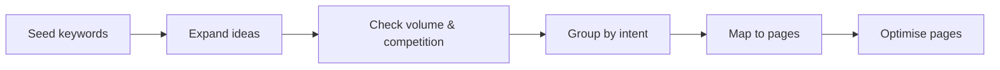

# Session 02: Practice Lab: Keyword Research and On-Page SEO

> Module: Introduction to SEO · Diploma in Digital Marketing · Term 1 · ⏱ ~2 hours

In this lab you will do what an SEO executive does in the first week with a new client: research keywords with free tools, group them by intent, map them to pages and optimise one page. The client is a fictional AC repair service in Karachi.

## 🎯 Learning Objectives

- Generate keyword ideas from Google Autocomplete, "People also ask" and Google Keyword Planner
- Evaluate keywords by volume, competition and intent
- Group keywords into clusters and map each cluster to one page
- Write optimised title tags, meta descriptions, headings and content outlines
- Check a page against an on-page SEO checklist

## 📖 Concepts Explained

### 1. The client

**"CoolFix AC Services"** repairs and installs split ACs across Karachi. It has a basic website with only a Home page. Summer is peak season; the owner wants more calls from Google.

### 2. Keyword research workflow

| Step | Tool (free) | Output |
|---|---|---|
| Seeds | Brainstorm with the client | "ac repair", "ac service", "ac installation" |
| Expand | Google Autocomplete, "People also ask", "Related searches" | 30 to 50 ideas |
| Volume | Google Keyword Planner (inside a Google Ads account) | Monthly search ranges |
| Competition | Look at the current top 10 results | Easy / medium / hard |
| Intent | Read the SERP: blogs = informational, service pages = transactional | Intent label |

### 3. Keyword clusters

A **cluster** is a group of keywords with the same meaning and intent. One page should target one cluster, not one keyword. This avoids **keyword cannibalisation** (two of your own pages competing for the same search).

| Cluster | Keywords | Page |
|---|---|---|
| AC repair (transactional) | ac repair karachi, ac repairing near me, split ac repair service | /ac-repair-karachi |
| AC installation | ac installation karachi, ac fitting charges | /ac-installation |
| AC gas refill | ac gas refill price, ac gas charging karachi | /ac-gas-refill |
| Informational | why ac not cooling, ac cleaning tips | /blog/ac-not-cooling |

### 4. Simple keyword scoring

Give each keyword a priority score: **Relevance (1-3) + Intent (1-3) + Ease (1-3)**. Start with keywords scoring 7 to 9.

## 💻 Practical Walkthrough

Open [`keyword-research.csv`](./keyword-research.csv) in Google Sheets and use [`on-page-checklist.md`](./on-page-checklist.md).

**Step 1: Seeds and ideas (20 min)**
1. In Google (incognito window, region Pakistan), type "ac repair" slowly and note Autocomplete suggestions.
2. Search "ac repair karachi". Write down questions under "People also ask" and terms under "Related searches".
3. Repeat for "ac service" and "ac gas".

**Step 2: Volume (20 min)**
1. Open [Google Keyword Planner](https://ads.google.com/home/tools/keyword-planner/) (needs a Google Ads account; you can create one without running ads by choosing expert mode).
2. Click **Discover new keywords**, enter seeds, set location **Pakistan** (or Karachi) and language **English**.
3. Note the "Avg. monthly searches" range and "Competition" for your list.

**Step 3: Score and cluster (20 min)** - add scores in the CSV, then sort by total. Group keywords into 4 clusters and give each a page URL.

**Step 4: Optimise the main page (30 min)** - for `/ac-repair-karachi` write:

| Element | Your version |
|---|---|
| Title | AC Repair in Karachi: Same-Day Service \| CoolFix |
| Meta description | Split AC not cooling? CoolFix technicians fix it the same day anywhere in Karachi. Transparent rates from PKR 2,500. Call or WhatsApp now. |
| H1 | AC Repair Service in Karachi |
| H2s | Common AC problems we fix · Our repair charges · Areas we cover · How it works · FAQs |
| Image alt | Technician repairing a split AC in a Karachi apartment |
| Internal links | to /ac-gas-refill and /ac-installation |

**Step 5: Check (10 min)** - tick the on-page checklist and fix gaps.

**How it works:** research shows what people search; clusters stop pages competing with each other; the optimised page clearly matches one intent, which is what search engines reward.

## 🧪 Lab Practice

1. Collect at least 30 keyword ideas for CoolFix from free Google features.
2. Add volume (or "unknown") and a priority score for each in the CSV.
3. Create four clusters and map each to a URL.
4. Write the full on-page plan for one cluster page.
5. Run the on-page checklist and list three improvements.

## 📝 Assignment

Do the same keyword research for a business of your choice (minimum 40 keywords, 5 clusters, full on-page plan for two pages). Submit the Google Sheet link.

## ❓ Quick Quiz

1. What is keyword cannibalisation?
2. Which free Google feature shows questions people ask?
3. "ac not cooling reasons" has which intent?
4. Where do you find Keyword Planner?
5. How many keyword clusters should one page target?

Show answers

1. When two of your own pages compete for the same keyword
2. "People also ask"
3. Informational
4. Inside Google Ads (Tools → Keyword Planner)
5. One

## 💼 Interview Questions

**1. Walk me through your keyword research process.**

> Seeds from the client, expand with Autocomplete, PAA and tools, check volume and SERP competition, label intent, cluster, prioritise and map each cluster to a page.

**2. Why target long-tail keywords for a new site?**

> They have less competition and clearer intent, so a new site can rank sooner and visitors convert better.

**3. How do you judge keyword difficulty without paid tools?**

> Look at who ranks in the top 10: big brands with strong pages mean hard; forums, thin pages or small sites mean opportunity.

## ✅ Summary

- Research flow: seeds → ideas → volume → intent → clusters → pages.
- Free tools (Autocomplete, PAA, Keyword Planner) give plenty of data.
- One page = one keyword cluster = one intent.
- Optimise title, description, URL, headings, content, images and links.
- Always finish with a checklist.

<!-- nav -->

---

[⬅ Previous](../Session-01-Search-Engines-On-Page-Off-Page-and-Mobile-SEO/README.md) · [🏠 Module Home](../README.md) · [Next ➡](../Session-03-Advanced-Technical-and-Voice-Search-SEO/README.md)

Prepared by Zeeshan Abbas · Aptech Learning North Nazimabad
