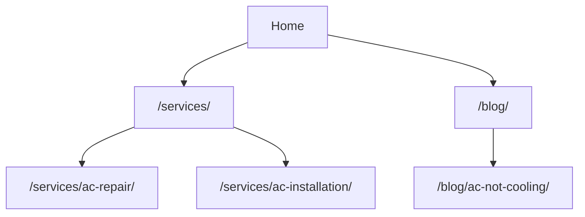

# Session 03: Advanced, Technical and Voice Search SEO

> Module: Introduction to SEO · Diploma in Digital Marketing · Term 1 · ⏱ ~2 hours

Great content cannot rank if Google cannot reach it, if the page takes ten seconds to load, or if the site is not secure. This session covers advanced SEO strategies, localisation and internationalisation, social media optimisation, essential SEO tools and Google Analytics basics, then technical SEO (architecture, URLs, crawlability, speed, HTTPS, security) and finally voice search with structured data and local SEO.

## 🎯 Learning Objectives

- Explain advanced SEO strategies such as topic clusters and featured snippets
- Define localisation and internationalisation, and use `hreflang`
- Describe Social Media Optimisation (SMO) and essential SEO tools, including Google Analytics basics
- Apply technical SEO: site architecture, URL structure, crawlability, indexability, page speed and HTTPS
- Create an XML sitemap and structured data (JSON-LD)
- Optimise content and local presence for voice search

## 📖 Concepts Explained

### 1. Advanced SEO strategies

| Strategy | What it means |
|---|---|
| **Topic clusters** | A main "pillar" page (e.g. "Complete Guide to Home Solar in Pakistan") linked to many detailed "cluster" posts (net metering, inverter types, prices). Shows depth of expertise. |
| **Featured snippets** | The answer box at the top of Google. Win it by giving a short, direct answer (40-50 words), a list or a table right under a question heading. |
| **Content refresh** | Update old, high-potential posts with new data and dates. |
| **E-E-A-T signals** | Author bios, real experience, sources, reviews, contact details. |
| **Search intent match** | Make the page type match what already ranks (guide vs product page). |

### 2. Localisation and internationalisation

- **Internationalisation (i18n):** preparing a site technically to support many languages/countries (URL structure, character encoding, `hreflang`).
- **Localisation (l10n):** adapting content for one market: language (Urdu/English), currency (PKR), examples, phone formats, holidays.

`hreflang` tells Google which page version is for which language/region:

```html
<link rel="alternate" hreflang="en-pk" href="https://www.example.com/en/">
<link rel="alternate" hreflang="ur-pk" href="https://www.example.com/ur/">
<link rel="alternate" hreflang="x-default" href="https://www.example.com/">
```

### 3. Social Media Optimisation (SMO)

SMO means optimising social profiles and content so they are found and shared: complete bios with keywords and website link, consistent brand name/handle, share buttons on articles, Open Graph tags so links show a nice preview, and posting content that earns discussion. More shares → more visibility → more chances of backlinks and brand searches.

### 4. Essential SEO tools

| Tool | Use | Cost |
|---|---|---|
| Google Search Console | Indexing status, search queries, clicks, errors, sitemaps | Free |
| Google Analytics 4 | Visitors, sources, engagement, conversions | Free |
| PageSpeed Insights / Lighthouse | Speed and Core Web Vitals | Free |
| GTmetrix | Detailed speed waterfall | Free tier |
| Screaming Frog SEO Spider | Crawl a site to find broken links, missing titles | Free up to 500 URLs |
| Semrush / Ahrefs | Keywords, backlinks, competitors | Paid (trials) |
| Yoast SEO / Rank Math | On-page SEO help inside WordPress | Free + paid |

**Google Analytics basics:** GA4 tracks **users**, **sessions**, **events** (page_view, click, form_submit) and **key events** (conversions). The Acquisition reports show where traffic comes from: Organic Search, Paid Search, Social, Direct, Referral. You will go deeper in the Analytics module.

### 5. Technical SEO



| Area | Best practice |
|---|---|
| Site architecture | Flat and logical; important pages within 3 clicks of home |
| URL structure | Lowercase, hyphens, short, descriptive; avoid `?id=123&cat=7` |
| Crawlability | Internal links to every page, XML sitemap, sensible robots.txt |
| Indexability | No accidental `noindex`, use canonical tags, avoid duplicate pages |
| Page speed | Compress images (WebP), lazy-load, cache, fewer heavy scripts, a CDN |
| Core Web Vitals | **LCP** (main content loads, aim ≤ 2.5 s), **INP** (responsiveness, aim ≤ 200 ms), **CLS** (layout stability, aim ≤ 0.1) |
| HTTPS | SSL/TLS certificate (free via Let's Encrypt on most hosts); redirect all http to https |
| Security | Updated CMS/plugins, strong passwords, backups, malware scans. Hacked sites lose rankings and get warning labels. |

### 6. Voice search optimisation

People speak in full questions: "Hey Google, where can I get biryani near me that's open now?" Voice queries are longer, conversational and often local.

How to adapt:
- Add **FAQ sections** with natural questions and short direct answers.
- Target **question keywords** (who, what, where, how, best, near me).
- Keep pages **fast and mobile-friendly** (voice answers come from quick, trusted pages).
- Use **structured data** so assistants understand facts (address, hours, prices, FAQs).
- Strong **local SEO**: complete Google Business Profile with hours, categories, photos and reviews.

**Structured data** is code (usually JSON-LD) using the Schema.org vocabulary that labels facts on a page. It can make pages eligible for rich results (stars, FAQs, business info).

## 💻 Code Examples

### Example 1: XML sitemap (`sitemap.xml`)

```xml
<?xml version="1.0" encoding="UTF-8"?>
<!-- A sitemap lists the pages you want search engines to find -->
<urlset xmlns="http://www.sitemaps.org/schemas/sitemap/0.9">
  <url>
    <loc>https://www.example.com/</loc>
    <lastmod>2026-10-01</lastmod>
  </url>
  <url>
    <loc>https://www.example.com/services/ac-repair/</loc>
    <lastmod>2026-09-20</lastmod>
  </url>
  <url>
    <loc>https://www.example.com/blog/ac-not-cooling/</loc>
    <lastmod>2026-09-05</lastmod>
  </url>
</urlset>
```

**How it works:** each `<url>` holds the full address (`<loc>`) and the last update date. Upload it to the site root and submit it in Search Console → Sitemaps. WordPress SEO plugins create it automatically.

### Example 2: Local business structured data (`local-business-schema.html`)

```html
<script type="application/ld+json">
{
  "@context": "https://schema.org",
  "@type": "LocalBusiness",
  "name": "CoolFix AC Services",
  "telephone": "+92-300-1234567",
  "url": "https://www.example.com",
  "address": {
    "@type": "PostalAddress",
    "streetAddress": "Block H, North Nazimabad",
    "addressLocality": "Karachi",
    "addressRegion": "Sindh",
    "addressCountry": "PK"
  },
  "openingHours": "Mo-Sa 09:00-21:00",
  "priceRange": "PKR 2500 - 15000"
}
</script>
```

**How it works:** the script goes inside the page `<head>` or `<body>`. It does not show to visitors; it tells search engines exact facts. Test it with Google's Rich Results Test.

### Example 3: FAQ structured data (`faq-schema.html`)

```html
<script type="application/ld+json">
{
  "@context": "https://schema.org",
  "@type": "FAQPage",
  "mainEntity": [{
    "@type": "Question",
    "name": "How much does AC repair cost in Karachi?",
    "acceptedAnswer": {
      "@type": "Answer",
      "text": "Most split AC repairs cost between PKR 2,500 and 8,000 depending on the fault."
    }
  }]
}
</script>
```

**How it works:** each question/answer pair must also be visible on the page. FAQ markup helps search engines and voice assistants understand question-style content (Google currently shows FAQ rich results mainly for authoritative government and health sites, but the markup still clarifies meaning).

### Example 4: Force HTTPS on Apache hosting (`.htaccess-https-example.txt`)

```apache
# Redirect every http request to https (permanent 301 redirect)
RewriteEngine On
RewriteCond %{HTTPS} off
RewriteRule ^(.*)$ https://%{HTTP_HOST}%{REQUEST_URI} [L,R=301]
```

**How it works:** on Apache hosts (most cPanel shared hosting), these lines in `.htaccess` send visitors and crawlers to the secure version with a 301 (permanent) redirect, so link value moves to https URLs.

## 🧪 Lab Practice

1. Edit `sitemap.xml` with five pages of your own (imaginary) business and validate its format in a browser.
2. Fill `local-business-schema.html` with your business details and test it at [Rich Results Test](https://search.google.com/test/rich-results) using the "Code" option.
3. Run [PageSpeed Insights](https://pagespeed.web.dev/) on two Pakistani news websites; record LCP, INP and CLS for mobile.
4. Write five voice-search questions customers might ask a pharmacy in your area, with 30-word answers.
5. Plan a topic cluster: one pillar and six cluster posts for a solar company.

## 📝 Assignment

Create a "technical starter kit" for a new website: robots.txt, sitemap.xml (8 URLs), LocalBusiness JSON-LD, one FAQ block (3 questions) and a short note on how you would make the site load fast.

## ❓ Quick Quiz

1. What does `hreflang` do?
2. Name the three Core Web Vitals.
3. Where do you submit a sitemap?
4. What vocabulary does structured data use?
5. Why are voice queries usually longer?

<details>
<summary>Show answers</summary>

1. Tells search engines which language/region version of a page to show
2. LCP, INP, CLS
3. Google Search Console → Sitemaps
4. Schema.org (usually written in JSON-LD)
5. People speak naturally in full questions

</details>

## 💼 Interview Questions

**1. A page is not appearing in Google. How do you investigate?**

> Use URL Inspection in Search Console, check for noindex, robots.txt blocks, canonical pointing elsewhere, missing internal links, or thin/duplicate content, then request indexing.

**2. Why does page speed matter for SEO?**

> It is part of page experience, affects Core Web Vitals, and slow pages lose visitors, which hurts conversions and engagement.

**3. What is the difference between localisation and translation?**

> Translation changes words; localisation adapts the whole experience: currency, examples, cultural references and local search terms.

## ✅ Summary

- Advanced SEO: topic clusters, featured snippets, refreshes and E-E-A-T.
- i18n prepares a site for many markets; l10n adapts content; `hreflang` connects versions.
- Free tools: Search Console, GA4, PageSpeed Insights, Screaming Frog.
- Technical SEO: clean architecture and URLs, crawlable, indexable, fast, HTTPS, secure.
- Sitemaps and JSON-LD structured data help search engines understand your site.
- Voice search favours fast pages with direct answers and strong local SEO.

<!-- nav -->

---

[⬅ Previous](../Session-02-Practice-Lab-Keyword-Research-and-On-Page-SEO/README.md) · [🏠 Module Home](../README.md) · [Next ➡](../Session-04-Practice-Lab-Technical-SEO-Audit/README.md)

Prepared by Zeeshan Abbas · Aptech Learning North Nazimabad
