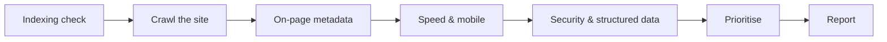

# Session 04: Practice Lab: Technical SEO Audit

> Module: Introduction to SEO · Diploma in Digital Marketing · Term 1 · ⏱ ~2 hours

An SEO audit is a health check-up for a website. In this lab you will audit a real public website using free tools (Google search operators, PageSpeed Insights, Screaming Frog, Rich Results Test and browser tools), record issues in a sheet, prioritise them, and write a short audit report for the "client".

## 🎯 Learning Objectives

- Run a structured technical SEO audit with free tools
- Check indexing, crawlability, URLs, titles, headings, speed, mobile usability and HTTPS
- Find broken links, missing metadata and duplicate titles with a crawler
- Prioritise issues by impact and effort
- Write a clear audit summary with recommendations

## 📖 Concepts Explained

### 1. Audit flow

### 2. Tools you will use

| Tool | What it checks | Link |
|---|---|---|
| Google `site:` search | Rough count of indexed pages, odd pages in index | google.com |
| Screaming Frog SEO Spider (free ≤ 500 URLs) | Status codes, titles, descriptions, H1s, redirects | screamingfrog.co.uk |
| PageSpeed Insights | Core Web Vitals and speed suggestions | pagespeed.web.dev |
| Rich Results Test | Structured data validity | search.google.com/test/rich-results |
| Browser view-source / DevTools | Meta tags, canonical, viewport, HTTPS | built into Chrome/Edge |
| Google Search Console | Best source if you own the site | search.google.com/search-console |

### 3. HTTP status codes to know

| Code | Meaning | SEO action |
|---|---|---|
| 200 | OK | Good |
| 301 | Permanent redirect | Fine for moved pages; update internal links |
| 302 | Temporary redirect | Use 301 if the move is permanent |
| 404 | Not found | Fix the link or redirect to a relevant page |
| 500 | Server error | Urgent: tell the developer/host |

### 4. Prioritising: impact vs effort

| | Low effort | High effort |
|---|---|---|
| **High impact** | Do first (quick wins): missing titles, http→https redirect, broken links | Plan next: speed overhaul, site restructure |
| **Low impact** | Do when free: alt text on decorative images | Skip or postpone |

## 💻 Practical Walkthrough

Use [`seo-audit-checklist.md`](./seo-audit-checklist.md) and record findings in [`audit-findings.csv`](./audit-findings.csv). Choose a small public business website (a local school, clinic or restaurant). Only use tools that read public pages; never try to log in or stress a site.

**Step 1: Indexing (10 min)** - search `site:domain.com`. Note the result count and look for strange pages (test pages, tag pages, old content).

**Step 2: Crawl (25 min)**
1. Install [Screaming Frog SEO Spider](https://www.screamingfrog.co.uk/seo-spider/) and enter the homepage URL; click **Start**.
2. **Response Codes** tab → filter **Client Error (4xx)**: record broken pages.
3. **Page Titles** tab → filters **Missing**, **Duplicate**, **Over 60 characters**.
4. **Meta Description** tab → **Missing** and **Duplicate**.
5. **H1** tab → **Missing** and **Multiple**.
6. **Images** tab → **Missing Alt Text**.

**Step 3: Speed and mobile (20 min)** - run the homepage and one inner page in PageSpeed Insights (mobile). Record performance score, LCP, INP, CLS and the top three "Opportunities".

**Step 4: Security and markup (15 min)**
1. Type `http://domain.com`: does it redirect to `https://`?
2. View source (Ctrl+U): find `viewport`, `canonical`, `robots` meta tags.
3. Paste the URL into the Rich Results Test; note detected structured data.
4. Open `domain.com/robots.txt` and `domain.com/sitemap.xml` (or `/sitemap_index.xml`).

**Step 5: Prioritise and report (20 min)** - label each issue High/Medium/Low impact and effort, then write a one-page summary: 3 strengths, top 5 issues, quick wins for this week.

**How it works:** each tool covers one layer of the site. Logging everything in one sheet with impact and effort turns a long list of problems into an action plan a client can follow.

## 🧪 Lab Practice

1. Complete all five steps for one website.
2. Log at least 10 findings in `audit-findings.csv`.
3. Classify each finding on the impact/effort grid.
4. Compare your homepage speed scores with one competitor.
5. Write the one-page audit summary.

## 📝 Assignment

Audit a second website in a different industry and present a 5-slide audit report: overview, indexing and crawl, speed and mobile, security and markup, prioritised action plan.

## ❓ Quick Quiz

1. What status code means "page not found"?
2. Which Screaming Frog tab shows duplicate titles?
3. Where can you quickly check if a site redirects to HTTPS?
4. What is a "quick win" in an audit?
5. Which free tool reports Core Web Vitals?

Show answers

1. 404
2. Page Titles
3. Type the http:// version in the browser address bar and see where it lands
4. A high-impact issue that needs little effort to fix
5. PageSpeed Insights (also Search Console if you own the site)

## 💼 Interview Questions

**1. What are the first five things you check in a technical audit?**

> Indexing (site: and Search Console), crawl errors (4xx/5xx), HTTPS and redirects, mobile usability and speed, and titles/meta/H1 issues.

**2. How do you handle hundreds of 404 errors?**

> Find which have backlinks or traffic and 301-redirect them to the most relevant live pages, fix internal links pointing to them, and let truly dead pages return 404.

**3. How do you present an audit to a non-technical client?**

> Lead with business impact, group issues into a short prioritised list, show quick wins and their expected effect, and keep technical details in an appendix.

## ✅ Summary

- An audit checks indexing, crawling, metadata, speed, mobile, security and markup.
- Free tools cover almost everything for small sites.
- Know status codes: 200, 301, 302, 404, 500.
- Prioritise with an impact/effort grid; start with quick wins.
- Report in business language with a clear action plan.

<!-- nav -->

---

[⬅ Previous](../Session-03-Advanced-Technical-and-Voice-Search-SEO/README.md) · [🏠 Module Home](../README.md) · [Next ➡](../Session-05-AI-and-Machine-Learning-in-SEO-and-UX/README.md)

Prepared by Zeeshan Abbas · Aptech Learning North Nazimabad
