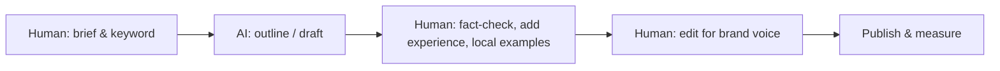

# Session 05: AI and Machine Learning in SEO and UX

> Module: Introduction to SEO · Diploma in Digital Marketing · Term 1 · ⏱ ~2 hours

Search engines now use machine learning to understand meaning, not just matching words, and marketers use AI to research keywords, draft content and predict trends. This session explains how AI and ML shape modern SEO, how to use AI tools responsibly for keyword research and content, the role of NLP and image/video recognition, predictive SEO, and why user experience (UX) is now an SEO factor.

## 🎯 Learning Objectives

- Explain the role of AI and machine learning in search engines and SEO
- Use AI tools for keyword research and content creation with human review
- Describe NLP and how search engines understand language and entities
- Explain AI image and video recognition and how to optimise media
- Describe predictive SEO analytics
- Link UX and mobile usability to SEO and apply AI-driven UX improvements

## 📖 Concepts Explained

### 1. AI and ML inside search engines

**Machine learning (ML)** lets software learn patterns from data instead of following fixed rules. Google uses ML systems to:

| System idea | What it does (simplified) |
|---|---|
| RankBrain | Helps interpret new or unusual queries by relating them to known ones |
| BERT | Understands words in context (e.g. "for", "to", "no" change meaning) |
| MUM / Gemini-based features | Understand complex, multi-step and multi-format questions; power AI Overviews |
| Spam detection (SpamBrain) | Detects spammy sites and link schemes |
| Helpful content signals | Reward people-first, original content |

**What this means for marketers:** you cannot "trick" an ML system with repeated keywords. Write naturally, cover topics thoroughly and satisfy the searcher.

**AI Overviews:** Google may show an AI-generated summary at the top for some queries, with links to sources. To be cited, pages need clear, trustworthy, well-structured answers.

### 2. AI-powered keyword research

AI chat tools (ChatGPT, Gemini, Copilot) and SEO suites with AI features (Semrush, Ahrefs, Surfer) can:
- brainstorm keyword ideas and questions by persona
- group keywords into clusters and label intent
- suggest content angles and titles

**Rule:** AI does not know real search volumes reliably. Always verify volumes and competition in Keyword Planner, Search Console or a paid tool.

### 3. AI-driven content creation: the human-in-the-loop process

Google's guidance focuses on content quality, not on whether AI helped. Mass-producing low-value AI pages to manipulate rankings is treated as spam. Add what AI cannot: real experience, photos, local prices, expert quotes.

### 4. Natural Language Processing (NLP)

**NLP** is the AI field that helps computers understand human language. Search engines use it to:
- identify **entities** (people, places, brands: "Faisal Mosque", "Islamabad")
- understand **sentiment** and **intent**
- connect **synonyms and related concepts** ("cheap" ≈ "affordable", "mobile" ≈ "phone")

**SEO tips:** use clear headings, define terms, mention related entities naturally, answer questions directly, use structured data.

### 5. AI image and video recognition

Google Lens and video understanding systems can identify objects, text in images and key moments in videos.

| Media | Optimisation |
|---|---|
| Images | Descriptive file names (`black-leather-handbag.webp`), alt text, relevant surrounding text, original photos, compressed WebP |
| Video | Clear title and description, chapters/timestamps, captions/transcript, VideoObject structured data, custom thumbnail |

### 6. Predictive SEO analytics

AI tools analyse past data (search trends, seasonality, rankings) to **forecast** what will be searched and which pages will grow or decline. Example: searches for "school uniform", "Eid dresses" or "AC repair" rise at predictable times in Pakistan; publish and update content **4 to 8 weeks before** the peak. Tools: Google Trends, Search Console data with forecasting in Sheets, and AI features in SEO suites.

### 7. UX and SEO

Search engines want to send users to pages that satisfy them. Good UX → people stay, engage and convert.

| UX factor | SEO link |
|---|---|
| Fast loading | Core Web Vitals |
| Mobile usability | Mobile-first indexing |
| Clear navigation | Crawlability, lower bounce |
| Readable content | Engagement, featured snippets |
| No intrusive pop-ups | Page experience guidelines |
| Accessibility (alt text, contrast) | Better for all users and crawlers |

**AI-driven UX optimisation:** heatmap and session-recording tools like Microsoft Clarity (free) use AI to summarise where users get stuck ("rage clicks", "dead clicks"); A/B testing tools; on-site AI search and recommendations; chatbots for instant answers.

**Engagement techniques:** answer the main question at the top, use a table of contents, visuals every few paragraphs, internal links to next steps, clear CTAs.

## 💻 Practical Walkthrough

Use the prompt sheet [`ai-seo-prompts.md`](./ai-seo-prompts.md).

**Walkthrough: AI-assisted keyword clustering for a Lahore bakery**

1. Open any AI chat tool. Paste prompt 1 from the sheet with "custom cakes Lahore" as the topic.
2. Review the list; delete irrelevant or invented terms.
3. Verify the top 15 in Google Keyword Planner and note real volumes.
4. Use prompt 3 to create an outline for "Custom Birthday Cakes in Lahore: Prices and Designs".
5. Edit the outline: add real prices (e.g. PKR 3,500 to 12,000 per kg range from your research), your own photos, delivery areas.
6. Use prompt 5 to generate five FAQ questions; keep the ones real customers ask.

**How it works:** AI speeds up brainstorming and structure; human checks provide accuracy, experience and local detail, which is what ranks and converts.

## 🧪 Lab Practice

1. Use AI to generate 30 keyword ideas for a topic; verify 10 in Keyword Planner and compare.
2. Ask AI to label intent for 15 keywords; check 5 by looking at the real SERP.
3. Rename and write alt text for five product images on a sample page.
4. Look up a seasonal keyword in [Google Trends](https://trends.google.com) (region Pakistan, past 5 years) and state the best month to publish.
5. Install Microsoft Clarity on a test WordPress site (or watch its demo) and list three UX insights it can give.

## 📝 Assignment

Produce one 800-word blog post with AI help, then submit three versions: the raw AI draft, your edited final, and a short note listing every fact you checked and every personal or local detail you added.

## ❓ Quick Quiz

1. What does NLP stand for?
2. Should you trust AI tools for exact search volumes?
3. Name two ways to optimise a video for search.
4. What is predictive SEO?
5. Name one free AI-powered UX analysis tool.

Show answers

1. Natural Language Processing
2. No; verify with Keyword Planner, Search Console or SEO tools
3. Any two: keyword-rich title/description, chapters, captions/transcript, VideoObject schema, thumbnail
4. Using data and AI to forecast search demand and plan content before peaks
5. Microsoft Clarity

## 💼 Interview Questions

**1. Does Google penalise AI-generated content?**

> Google judges quality and helpfulness, not the tool used. Low-value content made at scale to manipulate rankings is spam, whether written by AI or humans.

**2. How has machine learning changed keyword strategy?**

> Search engines understand meaning and intent, so we target topics and intent clusters with natural language rather than exact-match repetition.

**3. How is UX connected to SEO?**

> Search engines aim to satisfy users; fast, mobile-friendly, easy-to-use pages meet page experience signals and keep visitors engaged, supporting rankings and conversions.

## ✅ Summary

- Search engines use ML (RankBrain, BERT, newer AI) to understand meaning and fight spam.
- AI speeds up keyword research and drafting, but humans must verify and add experience.
- NLP understands entities, intent and context; write clearly and naturally.
- Optimise images and videos so AI recognition systems understand them.
- Predictive SEO plans content ahead of seasonal demand.
- Good UX and mobile usability support rankings; AI tools reveal UX problems.

<!-- nav -->

---

[⬅ Previous](../Session-04-Practice-Lab-Technical-SEO-Audit/README.md) · [🏠 Module Home](../README.md) · [Next ➡](../Session-06-Practice-Lab-AI-Assisted-Content-and-UX-Optimization/README.md)

Prepared by Zeeshan Abbas · Aptech Learning North Nazimabad
