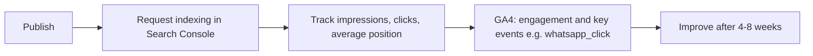

# Session 06: Practice Lab: AI-Assisted Content and UX Optimization

> Module: Introduction to SEO · Diploma in Digital Marketing · Term 1 · ⏱ ~2 hours

This final SEO lab combines everything: keyword research, on-page SEO, structured data, AI-assisted writing and UX. You will produce one complete, publish-ready SEO page for a local business, check its UX on mobile, and set up the measurement you would use after publishing.

## 🎯 Learning Objectives

- Write an SEO content brief from keyword research
- Use AI responsibly to outline and draft, then edit to a publishable standard
- Add on-page elements, internal links and FAQ structured data
- Review mobile UX and readability with free tools
- Plan how to measure the page in Search Console and GA4

## 📖 Concepts Explained

### 1. The content brief

A **content brief** is a one-page plan given to a writer (or yourself) before writing. It prevents off-topic content and saves editing time.

| Brief field | Example |
|---|---|
| Target keyword / cluster | home solar system price in pakistan, 5kw solar price, solar net metering cost |
| Intent | Commercial (comparing prices and options) |
| Persona | Homeowner in Lahore, monthly bill PKR 40,000+, wants to cut costs |
| Goal of page | Get WhatsApp enquiries for a free site survey |
| Must-cover sub-topics | System sizes, price ranges, net metering, payback, inverter types, FAQs |
| Competitor gaps | Most pages lack a payback example in PKR |
| Word count guide | About as thorough as top results (not a fixed number) |
| CTA | "Get a free rooftop survey on WhatsApp" |

### 2. Readability rules

- Sentences mostly under 20 words; paragraphs 2 to 4 lines.
- Use lists, tables and bold for key facts.
- Answer the main question in the first 2 to 3 sentences.
- Free checkers: Hemingway Editor, the readability panel in Yoast/Rank Math.

### 3. Mobile UX checklist

Thumb-friendly buttons (at least about 48 px tall), sticky WhatsApp/call button, no pop-up covering content on load, font size 16 px or larger, tables that scroll sideways, images that fit the screen.

### 4. Measuring after publishing

## 💻 Practical Walkthrough

Use [`content-brief-template.md`](./content-brief-template.md) and the starter page [`seo-page-starter.html`](./seo-page-starter.html).

**Step 1: Brief (20 min)** - fill the brief for "SunPower Lahore" (fictional solar installer) or your own business. Check the top 3 Google results and write the gaps.

**Step 2: AI outline and draft (25 min)** - give the AI your brief (not just the keyword). Ask for an outline first, approve or edit it, then ask for one section at a time.

**Step 3: Human edit (25 min)** - fact-check prices and policies (e.g. current net metering rules from official sources), add a local example ("A 5 kW system in Johar Town cut a PKR 45,000 bill to about PKR 12,000", clearly marked as an example), remove filler, keep brand voice.

**Step 4: Build the page (20 min)** - put your content into `seo-page-starter.html`:
1. Title and meta description in the `<head>`
2. One H1, logical H2s
3. A comparison table
4. FAQ section and matching FAQ JSON-LD
5. Internal links and a WhatsApp CTA

**Step 5: UX test (10 min)** - open the file in Chrome, press **F12 → Toggle device toolbar** and test on a phone size. Fix anything hard to read or tap.

**How it works:** the brief keeps the content aligned with intent; AI speeds drafting; your edits add trust and accuracy; the HTML structure and schema help search engines; the mobile test protects UX.

## 🧪 Lab Practice

1. Complete the content brief including competitor gaps.
2. Produce the AI outline and edited final copy (minimum 700 words).
3. Build the HTML page with title, meta, headings, table, FAQ and schema.
4. Validate the FAQ schema in the Rich Results Test (Code option).
5. Test the page at two mobile screen sizes and fix two UX issues.

## 📝 Assignment

**Module mini-deliverable:** submit the brief, the final HTML page, a screenshot of the schema test, and a measurement plan listing the Search Console and GA4 metrics you would check after 4 weeks.

## ❓ Quick Quiz

1. What is a content brief?
2. Why give AI the full brief instead of only a keyword?
3. What is the minimum comfortable font size for mobile body text?
4. Which Search Console metrics show SEO progress?
5. Where must FAQ answers also appear besides the JSON-LD?

Show answers

1. A one-page plan with keyword, intent, persona, sub-topics, gaps and CTA
2. It produces focused, relevant drafts that match intent and persona
3. About 16 px
4. Impressions, clicks, CTR and average position
5. Visibly on the page

## 💼 Interview Questions

**1. How do you make sure AI-assisted content is high quality?**

> Start with a detailed brief, draft section by section, fact-check every claim, add first-hand experience and local data, edit for voice and readability, and measure performance after publishing.

**2. What would you include in an SEO content brief?**

> Keyword cluster, intent, persona, page goal and CTA, required sub-topics, competitor gaps, internal links and any schema to add.

**3. A new page has impressions but few clicks. What do you do?**

> Improve the title and meta description to be more compelling and specific, check that the snippet matches intent, and consider adding structured data.

## ✅ Summary

- Every SEO page starts with a content brief.
- AI drafts quickly; humans add facts, experience and voice.
- Structure the page with clean HTML, tables, FAQs and schema.
- Test UX on mobile before publishing.
- Measure with Search Console and GA4, then improve.

<!-- nav -->

---

[⬅ Previous](../Session-05-AI-and-Machine-Learning-in-SEO-and-UX/README.md) · [🏠 Module Home](../README.md)

Prepared by Zeeshan Abbas · Aptech Learning North Nazimabad
