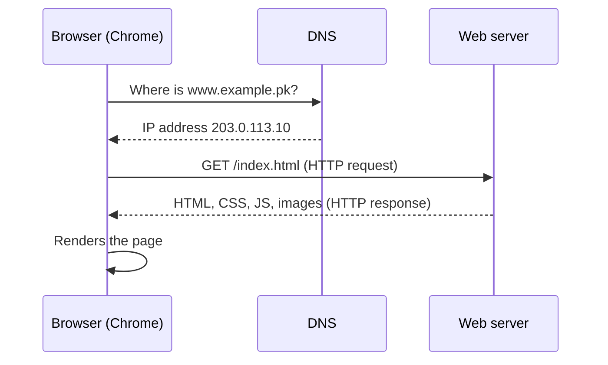

# Session 01: Introduction to the Web and HTML5

> Module: Essentials of Website Design and Development · Diploma in Digital Marketing · Term 1 · ⏱ ~2 hours

Digital marketers work with websites every day: editing landing pages, adding tracking codes, fixing meta tags, briefing developers. You do not need to become a full developer, but you must understand how web pages are built. This session introduces the web, the history of HTML, the structure of an HTML5 page, and the roles of CSS, JavaScript and jQuery.

## 🎯 Learning Objectives

- Explain how the web works and how HTML evolved into HTML5
- Describe the structure of an HTML page, including the doctype
- List the problems of HTML 4/XHTML and the new features of HTML5
- Identify the parts of a tag: element, attribute, value; container vs empty tags
- Use basic tags and HTML entities
- Explain the roles of CSS, JavaScript and jQuery, browser support and HTML5 on mobile

## 📖 Concepts Explained

### 1. How the web works



A **web page** is a text file written in **HTML** (HyperText Markup Language). The browser reads the HTML and draws the page. **Hypertext** means text with links to other pages.

### 2. Evolution of HTML

| Version | Year | Key point |
|---|---|---|
| HTML (first) | 1991 | Tim Berners-Lee: simple documents with links |
| HTML 2.0 / 3.2 | 1995-1997 | Tables, forms, more formatting |
| HTML 4.01 | 1999 | Separation of style into CSS encouraged |
| XHTML 1.0 | 2000 | HTML rewritten with strict XML rules |
| HTML5 | 2014 (W3C) | Semantic tags, audio/video, forms, mobile |
| HTML Living Standard | ongoing | Maintained by WHATWG; updated continuously |

### 3. Drawbacks of HTML 4 and XHTML

- No built-in audio/video: needed plugins like Flash.
- Generic `<div>` everywhere; no meaning for header, nav, article.
- Weak form controls (no email, date or number inputs).
- XHTML was very strict: one small error could break the page.
- Poor support for mobile devices and offline apps.

### 4. New features of HTML5

| Feature | Examples |
|---|---|
| Semantic elements | `<header>`, `<nav>`, `<main>`, `<section>`, `<article>`, `<footer>` |
| Media | `<audio>`, `<video>` without plugins |
| Graphics | `<canvas>`, inline `<svg>` |
| Forms | `type="email"`, `date`, `tel`, `number`, `required`, `placeholder` |
| APIs | Geolocation, local storage, drag and drop |
| Simple doctype | `<!DOCTYPE html>` |

**HTML5 and mobile:** the viewport meta tag, responsive images, touch-friendly inputs (`type="tel"` opens the number keypad), geolocation for "near me" features, and offline storage make HTML5 the foundation of mobile websites and many hybrid apps.

### 5. HTML, CSS, JavaScript and jQuery

| Technology | Role | Analogy (a house) |
|---|---|---|
| HTML | Structure and content | Walls, rooms, doors |
| CSS | Presentation: colours, fonts, layout | Paint, furniture, decoration |
| JavaScript | Behaviour and interaction | Electricity: lights, fans, doorbell |
| jQuery | A JavaScript library with shorter syntax | A ready-made switchboard |

jQuery was hugely popular for cross-browser code; modern JavaScript now does most of the same things, but you will still meet jQuery on many WordPress sites.

### 6. Browser support

Modern browsers (Chrome, Edge, Firefox, Safari, Samsung Internet) support HTML5 well. Check a feature at [caniuse.com](https://caniuse.com) before relying on it.

### 7. Anatomy of a tag

```text
<a href="https://example.pk" title="Home">Visit us</a>
 │  │            │                         │       │
 │  attribute    value                     content closing tag
 element (opening tag)
```

| Term | Meaning |
|---|---|
| Element | Opening tag + content + closing tag |
| Attribute | Extra information, written `name="value"` in the opening tag |
| Container tag | Has content and a closing tag: `<p>...</p>` |
| Empty / standalone tag | No content, no closing tag: `<br>`, `<hr>`, ``, `<meta>` |

**Common global attributes:** `id`, `class`, `style`, `title`, `lang`. **Attribute values** are text, numbers, URLs, or keywords (e.g. `type="email"`).

### 8. The doctype and basic page structure

`<!DOCTYPE html>` must be the first line. It tells the browser to use standards mode. Then `<html>` contains `<head>` (information about the page) and `<body>` (visible content).

| Basic tag | Purpose |
|---|---|
| `<title>` | Browser tab text and search result title |
| `<meta>` | Charset, viewport, description |
| `<h1>`-`<h6>` | Headings |
| `<p>` | Paragraph |
| `<br>` / `<hr>` | Line break / horizontal rule |
| `<a>` | Link |
| `` | Image |
| `<!-- -->` | Comment (not shown) |

### 9. HTML entities

Some characters have special meaning in HTML (`<`, `>`, `&`). To show them, use **entities**: `&lt;` `&gt;` `&amp;` `&quot;` `&copy;` `&nbsp;`.

## 💻 Code Examples

Open each file in VS Code, then right-click → **Open with Live Server** (extension) or double-click to open in the browser.

### Example 1: Your first HTML5 page (`first-page.html`)

```html
<!DOCTYPE html>                     <!-- 1. Tells the browser: this is HTML5 -->
<html lang="en">                    <!-- 2. Root element; lang helps screen readers and search engines -->
<head>                              <!-- 3. Information ABOUT the page (not shown in the page body) -->
  <meta charset="UTF-8">            <!-- 4. Character set so Urdu, symbols and emojis display correctly -->
  <meta name="viewport" content="width=device-width, initial-scale=1">  <!-- 5. Mobile-friendly scaling -->
  <title>My First Web Page</title>  <!-- 6. Text shown on the browser tab and in Google results -->
</head>
<body>                              <!-- 7. Everything visitors see goes inside body -->
  <h1>Welcome to Chai Corner</h1>
  <p>Fresh karak chai in North Nazimabad, Karachi.</p>
</body>
</html>
```

**How it works:** the doctype switches on HTML5 standards mode; `head` holds settings the visitor does not see; `body` holds visible content. Comments explain each line.

### Example 2: Anatomy of tags (`tag-anatomy.html`)

```html
<!DOCTYPE html>
<html lang="en">
<head>
  <meta charset="UTF-8">
  <title>Tag Anatomy</title>
</head>
<body>
  <!-- Container tag: opening tag + content + closing tag -->
  <p>This is a paragraph.</p>

  <!-- Attribute: extra information inside the opening tag (name="value") -->
  <a href="https://www.google.com" title="Go to Google">Visit Google</a>

  <!-- Empty (standalone) tags: no closing tag and no content -->
  <br>
  <hr>
  

  <!-- Nesting: tags inside tags must close in reverse order -->
  <p>This word is <strong>important</strong>.</p>
</body>
</html>
```

**How it works:** shows container tags, attributes, empty tags and correct nesting in one small page.

### Example 3: Entities (`entities.html`)

```html
<!DOCTYPE html>
<html lang="en">
<head>
  <meta charset="UTF-8">
  <title>HTML Entities</title>
</head>
<body>
  <!-- Entities display characters that have a special meaning in HTML -->
  <p>Use &lt;p&gt; to make a paragraph.</p>          <!-- shows: Use <p> to make a paragraph. -->
  <p>Salt &amp; Pepper Restaurant</p>                 <!-- & sign -->
  <p>&copy; 2026 Chai Corner. All rights reserved.</p> <!-- © symbol -->
  <p>Price:&nbsp;PKR&nbsp;250</p>                      <!-- non-breaking spaces keep words together -->
  <p>He said &quot;hello&quot;.</p>                    <!-- double quotes -->
</body>
</html>
```

**How it works:** entities let you display special characters safely; `&nbsp;` keeps "PKR 250" on one line.

### Example 4: HTML, CSS, JavaScript and jQuery together (`html-css-js-jquery.html`)

```html
<!DOCTYPE html>
<html lang="en">
<head>
  <meta charset="UTF-8">
  <meta name="viewport" content="width=device-width, initial-scale=1">
  <title>HTML + CSS + JavaScript + jQuery</title>
  <!-- CSS controls how things LOOK -->
  <style>
    h1 { color: darkgreen; }
    .offer { background: #fff3cd; padding: 10px; }
  </style>
  <!-- jQuery library loaded from its official CDN -->
  <script src="https://code.jquery.com/jquery-3.7.1.min.js"></script>
</head>
<body>
  <!-- HTML gives STRUCTURE -->
  <h1>Chai Corner</h1>
  <button id="jsButton">Show offer (JavaScript)</button>
  <button id="jqButton">Hide offer (jQuery)</button>
  <p class="offer" id="offer" style="display:none">2 cups for PKR 200 today!</p>

  <script>
    // Plain JavaScript adds BEHAVIOUR: show the offer when clicked
    document.getElementById("jsButton").addEventListener("click", function () {
      document.getElementById("offer").style.display = "block";
    });

    // jQuery does the same kind of thing with shorter code
    $("#jqButton").click(function () {
      $("#offer").hide();
    });
  </script>
</body>
</html>
```

**How it works:** HTML creates the heading, buttons and paragraph; CSS colours them; JavaScript shows the offer on click; jQuery hides it with a one-line command.

## 🧪 Lab Practice

1. Install VS Code and the Live Server extension; open `first-page.html` and change the heading to your own business name.
2. In `tag-anatomy.html`, add one more link with a `title` attribute and one more empty tag.
3. Add three new entities (`&reg;`, `&trade;`, `&euro;`) to `entities.html` and view the result.
4. Press **Ctrl+U** on any Pakistani news website and find the doctype, title and one meta tag.
5. In `html-css-js-jquery.html`, change the offer text and the heading colour.

## 📝 Assignment

Write a one-page comparison (table format) of HTML 4, XHTML and HTML5 with at least six differences, and create an HTML5 page that uses at least eight different basic tags and three entities.

## ❓ Quick Quiz

1. What must be the first line of an HTML5 document?
2. Is `` a container or empty tag?
3. Which entity shows the `&` symbol?
4. Which technology controls the look of a page?
5. Name two new HTML5 semantic elements.

<details>
<summary>Show answers</summary>

1. `<!DOCTYPE html>`
2. Empty (standalone)
3. `&amp;`
4. CSS
5. Any two: header, nav, main, section, article, aside, footer

</details>

## 💼 Interview Questions

**1. Why should a digital marketer learn HTML?**

> To edit landing pages, add tracking and meta tags, fix SEO issues, write HTML emails and communicate clearly with developers.

**2. What is the difference between an element and an attribute?**

> An element is a building block like `<p>...</p>`. An attribute adds extra information to an element, such as `href` on a link.

**3. What does the viewport meta tag do?**

> It tells mobile browsers to match the page width to the device screen so the page is readable without zooming.

## ✅ Summary

- The browser requests HTML files from a server and renders them.
- HTML evolved from simple documents to HTML5, now a living standard.
- HTML5 adds semantic tags, media, better forms and mobile support.
- HTML = structure, CSS = style, JavaScript/jQuery = behaviour.
- Tags have attributes; some are containers, others are empty; entities show special characters.

<!-- nav -->

---

[🏠 Module Home](../README.md) · [Next ➡](../Session-02-Practice-Lab-Your-First-HTML5-Pages/README.md)

Prepared by Zeeshan Abbas · Aptech Learning North Nazimabad
