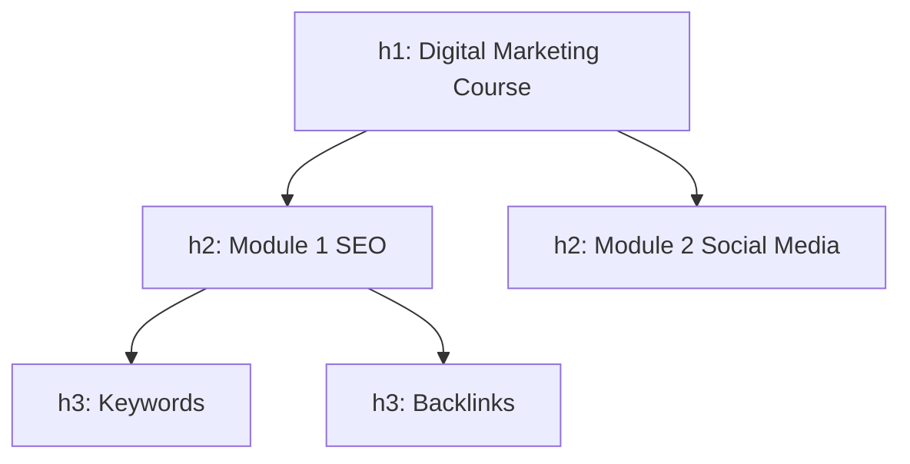

# Session 03: Formatting Text, Lists, Hyperlinks and Anchors

> Module: Essentials of Website Design and Development · Diploma in Digital Marketing · Term 1 · ⏱ ~2 hours

Well-formatted text is easier to read, scan and rank. Links are what make the web a "web": they move visitors from an ad to a landing page, from a blog to a product, from a page to WhatsApp. This session covers headings, formatting tags, monospaced and preformatted text, block quotes, lists, backgrounds, and every kind of hyperlink, including absolute vs relative paths and anchors.

## 🎯 Learning Objectives

- Use heading tags correctly for structure and SEO
- Apply formatting tags: strong, em, mark, del, ins, sub, sup, small, code, pre, blockquote
- Create ordered, unordered, description and nested lists
- Set background colour and image with CSS
- Explain absolute and relative paths
- Link to web pages, email, phone, files and anchors on the same or another page

## 📖 Concepts Explained

### 1. Headings

`<h1>` to `<h6>` create a document outline, like chapters and sub-chapters in a book. Rules: **one `<h1>` per page**, do not skip levels for styling, and never choose a heading just to make text big (use CSS for size).



### 2. Formatting tags

| Tag | Meaning | Typical look |
|---|---|---|
| `<strong>` | Strong importance | Bold |
| `<b>` | Bold for style only | Bold |
| `<em>` | Emphasis (stress) | Italic |
| `<i>` | Alternate voice, terms | Italic |
| `<mark>` | Highlight | Yellow background |
| `<del>` / `<ins>` | Deleted / inserted text | Strikethrough / underline |
| `<sub>` / `<sup>` | Subscript / superscript | Lowered / raised |
| `<small>` | Fine print | Smaller |
| `<code>` | Inline code | Monospaced |
| `<pre>` | Preformatted: keeps spaces and line breaks | Monospaced block |
| `<blockquote>` | Long quotation (testimonials) | Indented block |

**Monospaced font** gives every character the same width, useful for code and aligned text. Prefer meaningful tags (`strong`, `em`) because screen readers and search engines understand them.

### 3. Lists

| List | Tag | Use |
|---|---|---|
| Unordered | `<ul><li>` | Features, benefits (order not important) |
| Ordered | `<ol><li>` | Steps, rankings; `type` (1, A, a, I, i) and `start` attributes |
| Description | `<dl><dt><dd>` | FAQs, glossaries, specifications |
| Nested | a list inside an `<li>` | Menus, sub-categories |

### 4. Background colour and image

Old HTML used `bgcolor` and `background` attributes; these are obsolete. Use CSS: `background-color`, `background-image`, `background-size: cover`, `background-position`. Always add a fallback colour in case the image fails to load, and keep text readable (enough contrast).

### 5. Hyperlinks

A link uses the anchor element `<a href="...">`. Key attributes:

| Attribute | Purpose |
|---|---|
| `href` | Destination |
| `target="_blank"` | Open in new tab (add `rel="noopener"`) |
| `title` | Tooltip |
| `download` | Download the file instead of opening it |

### 6. Absolute vs relative paths

| Type | Example | Use |
|---|---|---|
| Absolute | `https://www.daraz.pk/` | Other websites |
| Relative (same folder) | `about.html` | Pages in your site |
| Relative (sub-folder) | `images/logo.png` | Files inside a folder |
| Relative (parent folder) | `../index.html` | Go up one folder |
| Root-relative | `/contact.html` | From the site root (works on a server) |

> **Analogy:** an absolute path is a full postal address ("House 12, Block H, North Nazimabad, Karachi"); a relative path is directions from where you stand ("the house next door").

### 7. Special links and anchors

- `mailto:` opens email (add `?subject=` to pre-fill a subject; spaces as `%20`).
- `tel:` opens the dialler.
- **Anchors:** give an element an `id`, then link with `#id` (same page) or `page.html#id` (another page). Great for FAQs, long guides and "Back to top".
- Images can be links: put `` inside `<a>`.

## 💻 Code Examples

### Example 1: Headings and formatting (`headings-and-formatting.html`)

```html
<!DOCTYPE html>
<html lang="en">
<head>
  <meta charset="UTF-8">
  <title>Headings and Text Formatting</title>
</head>
<body>
  <!-- Headings: h1 is the most important, h6 the least -->
  <h1>Digital Marketing Course</h1>
  <h2>Module 1: SEO</h2>
  <h3>Lesson 1: Keywords</h3>

  <!-- Meaningful (semantic) formatting -->
  <p><strong>Important:</strong> classes start on Monday.</p>   <!-- strong importance (bold) -->
  <p>This offer is <em>only</em> for students.</p>               <!-- emphasis (italic) -->
  <p>Old price <del>PKR 40,000</del> new price <ins>PKR 30,000</ins></p>
  <p>Use <mark>long-tail keywords</mark> for faster results.</p>  <!-- highlighted text -->
  <p>H<sub>2</sub>O and 10<sup>2</sup></p>                         <!-- subscript and superscript -->
  <p><small>Terms and conditions apply.</small></p>

  <!-- Monospaced and preformatted text -->
  <p>Type the command <code>site:example.pk</code> in Google.</p>
  <pre>
Name:    Ali
Course:  SEO
Fee:     PKR 30,000
  </pre>

  <!-- Block quotation for testimonials -->
  <blockquote cite="https://example.pk/reviews">
    "This course helped me get my first freelance client."
  </blockquote>
  <p>&mdash; Sara, Lahore</p>
</body>
</html>
```

**How it works:** headings build the outline; `strong`, `em`, `del`/`ins` and `mark` add meaning; `code` and `pre` use monospaced font; `blockquote` presents a testimonial.

### Example 2: Lists (`lists.html`)

```html
<!DOCTYPE html>
<html lang="en">
<head>
  <meta charset="UTF-8">
  <title>Lists</title>
</head>
<body>
  <!-- Unordered list: order does not matter -->
  <h2>Why choose us</h2>
  <ul>
    <li>Free delivery in Karachi</li>
    <li>Cash on delivery</li>
    <li>7-day returns</li>
  </ul>

  <!-- Ordered list: steps in order -->
  <h2>How to order</h2>
  <ol>
    <li>Choose your product</li>
    <li>Add to cart</li>
    <li>Pay or choose COD</li>
  </ol>

  <!-- Ordered list starting from a different number and type -->
  <ol type="A" start="3">
    <li>Option C</li>
    <li>Option D</li>
  </ol>

  <!-- Description list: term + description (great for FAQs and glossaries) -->
  <h2>Marketing terms</h2>
  <dl>
    <dt>CTR</dt>
    <dd>Click-through rate: clicks divided by impressions.</dd>
    <dt>CPC</dt>
    <dd>Cost per click.</dd>
  </dl>

  <!-- Nested list: a list inside a list item -->
  <ul>
    <li>Courses
      <ul>
        <li>SEO</li>
        <li>Social Media</li>
      </ul>
    </li>
  </ul>
</body>
</html>
```

**How it works:** shows all four list styles. Description lists are ideal for FAQs and term definitions.

### Example 3: Backgrounds (`background.html`)

```html
<!DOCTYPE html>
<html lang="en">
<head>
  <meta charset="UTF-8">
  <title>Background Colour and Image</title>
  <style>
    /* Modern way: set backgrounds with CSS (the old bgcolor attribute is obsolete) */
    body {
      background-color: #f4f8f4;             /* light green page colour */
    }
    .hero {
      background-image: url("images/chai.jpg"); /* image path relative to this file */
      background-size: cover;                 /* fill the box */
      background-position: center;
      background-color: #2e7d32;              /* fallback colour if the image is missing */
      color: white;
      padding: 60px 20px;
    }
  </style>
</head>
<body>
  <div class="hero">
    <h1>Fresh Karak Chai</h1>
    <p>Open till 2 am</p>
  </div>
  <p>The page background is light green; the banner uses an image with a fallback colour.</p>
</body>
</html>
```

**How it works:** CSS sets a page colour and a banner image with `cover` sizing and a fallback colour.

### Example 4: Every kind of link (`links.html`)

```html
<!DOCTYPE html>
<html lang="en">
<head>
  <meta charset="UTF-8">
  <title>Hyperlinks and Anchors</title>
</head>
<body>
  <!-- Anchor target near the top -->
  <h1 id="top">Hyperlink Examples</h1>

  <!-- 1. Absolute URL: full address to another website -->
  <p><a href="https://www.google.com/">Google</a></p>

  <!-- 2. Absolute URL opening in a new tab (rel protects security) -->
  <p><a href="https://developer.mozilla.org/" target="_blank" rel="noopener">MDN Web Docs (new tab)</a></p>

  <!-- 3. Relative paths: links to files in YOUR site -->
  <p><a href="lists.html">Same folder</a></p>
  <p><a href="images/chai.jpg">Sub-folder file</a></p>
  <p><a href="../README.md">One folder up</a></p>

  <!-- 4. Email and phone links -->
  <p><a href="mailto:info@example.pk?subject=Course%20enquiry">Email us</a></p>
  <p><a href="tel:+922134567890">Call 021-34567890</a></p>

  <!-- 5. Link to a section on the same page (anchor) -->
  <p><a href="#faq">Jump to FAQ</a></p>

  <!-- 6. Link to a downloadable file -->
  <p><a href="brochure.pdf" download>Download brochure</a></p>

  <!-- 7. An image as a link -->
  <a href="https://wa.me/923001234567"></a>

  <div style="height:800px"></div> <!-- empty space so the jump is visible -->

  <h2 id="faq">FAQ</h2>
  <p>Classes are held on weekends.</p>
  <p><a href="#top">Back to top</a></p>
</body>
</html>
```

**How it works:** absolute links go to other sites, relative links to your own files, `mailto:` and `tel:` start actions, `#faq` jumps within the page and `download` downloads a file.

## 🧪 Lab Practice

1. In `headings-and-formatting.html`, add a second testimonial and a price comparison using `del` and `ins`.
2. Convert an FAQ of five questions into a description list.
3. Add your own image to an `images/` folder and use it as the banner in `background.html`.
4. Add a link that opens WhatsApp with a pre-filled message using `?text=Hello%20I%20want%20details`.
5. Build a long page with a table of contents at the top linking to four sections by anchor.

## 📝 Assignment

Create a "Complete Guide" page (e.g. "Guide to Buying a Laptop in Pakistan") with one H1, at least four H2s, a table of contents using anchors, an ordered and an unordered list, a description-list FAQ, a blockquote testimonial, and links: one absolute, one relative, one email and one phone.

## ❓ Quick Quiz

1. How many `<h1>` tags should a page normally have?
2. Which tag keeps spaces and line breaks exactly as typed?
3. Write the link to jump to an element with `id="pricing"`.
4. Is `images/logo.png` an absolute or relative path?
5. Which list type best suits an FAQ?

<details>
<summary>Show answers</summary>

1. One
2. `<pre>`
3. `<a href="#pricing">Pricing</a>`
4. Relative
5. Description list (`<dl>`)

</details>

## 💼 Interview Questions

**1. Why are headings important for SEO?**

> They give search engines and screen readers a clear outline of the page topic and sub-topics, and help users scan content.

**2. When would you use `target="_blank"`?**

> For links to external sites or documents where you want the user to keep your page open; add `rel="noopener"` for security.

**3. What is the difference between `<strong>` and `<b>`?**

> `<strong>` marks important content (meaningful); `<b>` only draws attention visually without extra importance.

## ✅ Summary

- One H1, then logical H2-H6 for structure.
- Use meaningful formatting tags; `pre` and `code` for monospaced text.
- Four list types: unordered, ordered, description, nested.
- Backgrounds belong in CSS with a fallback colour.
- Absolute paths for other sites, relative for your own files; anchors jump to sections.

<!-- nav -->

---

[⬅ Previous](../Session-02-Practice-Lab-Your-First-HTML5-Pages/README.md) · [🏠 Module Home](../README.md) · [Next ➡](../Session-04-Practice-Lab-Multi-Page-Linked-Website/README.md)

Prepared by Zeeshan Abbas · Aptech Learning North Nazimabad
