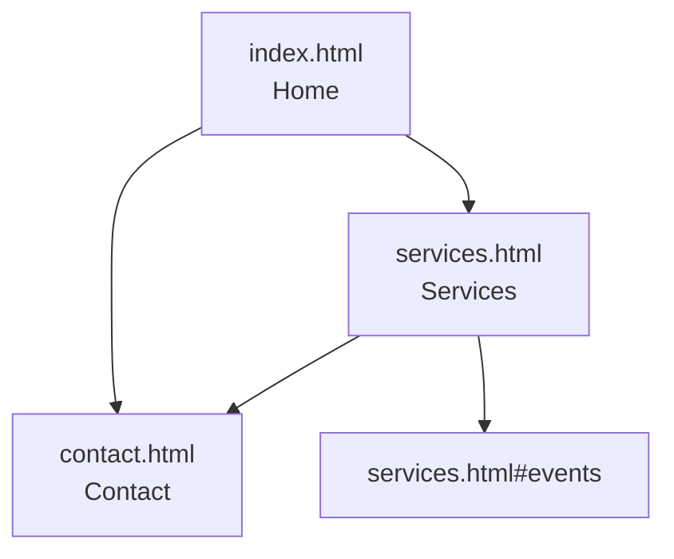

# Session 04: Practice Lab: Multi-Page Linked Website

> Module: Essentials of Website Design and Development · Diploma in Digital Marketing · Term 1 · ⏱ ~2 hours

In this lab you build a small three-page website for a florist in Lahore, linked with a shared navigation menu, anchors and contact links. It has no CSS yet; you will style it in the next sessions. The goal is to master structure and linking, which every landing page and website depends on.

## 🎯 Learning Objectives

- Plan a small website with a site map and folder structure
- Create several HTML pages with a consistent navigation menu
- Link between pages and to sections on other pages
- Use the `<address>` element and conversion links (tel, WhatsApp, email)
- Test every link and fix broken paths

## 📖 Concepts Explained

### 1. Plan before you code



Folder structure:

```text
mini-site/
├── index.html
├── services.html
├── contact.html
└── images/        (add your own photos here)
```

### 2. Consistent navigation

Every page repeats the same `<nav>` with relative links. Users always know where they are and can reach any page in one click. (Later you will learn how CMSs like WordPress do this automatically.)

### 3. Linking to a section on another page

`services.html#events` opens the Services page and scrolls to the element with `id="events"`. Useful for links from ads or emails to a specific offer.

### 4. Pre-filled WhatsApp messages

`https://wa.me/923001234567?text=Hi%2C%20I%20want%20to%20order%20flowers` opens WhatsApp with a ready message. Spaces become `%20` and commas `%2C` (URL encoding). Pre-filled text also helps the business know which page the lead came from.

### 5. Testing links

| Test | How |
|---|---|
| Click every nav link on every page | Manual |
| Check anchors land on the right section | Manual |
| Check phone and WhatsApp links on a real phone | Send yourself the files or use Live Server on Wi-Fi |
| Automated check | W3C Link Checker (validator.w3.org/checklink) once the site is online |

## 💻 Code Examples

### Example 1: Home page (`mini-site/index.html`)

```html
<!DOCTYPE html>
<html lang="en">
<head>
  <meta charset="UTF-8">
  <meta name="viewport" content="width=device-width, initial-scale=1">
  <title>Bloom Florist Lahore | Fresh Flowers Delivered</title>
  <meta name="description" content="Order fresh bouquets in Lahore with same-day delivery. Roses, gift baskets and event decor.">
</head>
<body>
  <!-- Same navigation menu on every page (relative links) -->
  <nav>
    <a href="index.html">Home</a> |
    <a href="services.html">Services</a> |
    <a href="contact.html">Contact</a>
  </nav>

  <h1>Fresh Flowers Delivered in Lahore</h1>
  <p>Same-day delivery across Lahore when you order before 4 pm.</p>

  <h2>Popular bouquets</h2>
  <ul>
    <li>Red Rose Bouquet &ndash; PKR 3,500</li>
    <li>Mixed Seasonal Flowers &ndash; PKR 2,800</li>
    <li>Gift Basket with Chocolates &ndash; PKR 5,500</li>
  </ul>

  <!-- Link to a section on another page -->
  <p><a href="services.html#events">See our event decoration service</a></p>
  <p><a href="contact.html">Order now</a></p>

  <hr>
  <p><small>&copy; 2026 Bloom Florist Lahore</small></p>
</body>
</html>
```

**How it works:** the nav links use relative paths; `services.html#events` jumps into a section of another page; each page has its own title and meta description for SEO.

### Example 2: Services page with anchors (`mini-site/services.html`)

```html
<!DOCTYPE html>
<html lang="en">
<head>
  <meta charset="UTF-8">
  <meta name="viewport" content="width=device-width, initial-scale=1">
  <title>Services | Bloom Florist Lahore</title>
  <meta name="description" content="Bouquets, gift baskets and wedding and event flower decoration in Lahore.">
</head>
<body>
  <nav>
    <a href="index.html">Home</a> |
    <a href="services.html">Services</a> |
    <a href="contact.html">Contact</a>
  </nav>

  <h1 id="top">Our Services</h1>
  <!-- Mini table of contents using anchors -->
  <ol>
    <li><a href="#bouquets">Bouquets</a></li>
    <li><a href="#baskets">Gift baskets</a></li>
    <li><a href="#events">Event decoration</a></li>
  </ol>

  <h2 id="bouquets">Bouquets</h2>
  <p>Hand-tied bouquets made fresh every morning.</p>

  <h2 id="baskets">Gift baskets</h2>
  <p>Flowers with chocolates, cakes or perfume.</p>

  <h2 id="events">Event decoration</h2>
  <p>Mehndi, nikah and corporate events. Packages from PKR 40,000.</p>

  <p><a href="contact.html">Request a quote</a> &middot; <a href="#top">Back to top</a></p>
</body>
</html>
```

**How it works:** a small table of contents links to sections by `id`; the "events" section can be reached from the home page.

### Example 3: Contact page (`mini-site/contact.html`)

```html
<!DOCTYPE html>
<html lang="en">
<head>
  <meta charset="UTF-8">
  <meta name="viewport" content="width=device-width, initial-scale=1">
  <title>Contact | Bloom Florist Lahore</title>
  <meta name="description" content="Call, WhatsApp or email Bloom Florist Lahore to order flowers.">
</head>
<body>
  <nav>
    <a href="index.html">Home</a> |
    <a href="services.html">Services</a> |
    <a href="contact.html">Contact</a>
  </nav>

  <h1>Contact Us</h1>
  <address>
    Bloom Florist, Main Boulevard, Gulberg III, Lahore<br>
    Phone: <a href="tel:+924235000000">042-35000000</a><br>
    WhatsApp: <a href="https://wa.me/923001234567?text=Hi%2C%20I%20want%20to%20order%20flowers">0300-1234567</a><br>
    Email: <a href="mailto:orders@example.pk">orders@example.pk</a>
  </address>

  <h2>Opening hours</h2>
  <p>Monday to Saturday: 10 am &ndash; 9 pm</p>

  <p><a href="index.html">Back to home</a></p>
</body>
</html>
```

**How it works:** `<address>` marks contact information; tel, WhatsApp (with pre-filled text) and mailto links give three ways to convert.

## 🧪 Lab Practice

1. Copy the `mini-site` folder and change the business to your own idea (keep three pages).
2. Add a fourth page `about.html` and update the nav on all pages.
3. Add a table of contents with anchors on the Services page for at least four services.
4. Create a pre-filled WhatsApp link that says which page the visitor came from (e.g. "from Services page").
5. Click-test every link and write down any broken ones; fix them.

## 📝 Assignment

Build a five-page site (Home, About, Services, Gallery, Contact) for a local business with consistent navigation, at least six anchors, one cross-page anchor link, and validated HTML on every page. Zip the folder and submit.

## ❓ Quick Quiz

1. What does `services.html#events` do?
2. Which element marks contact information?
3. How is a space written in a URL?
4. Why must the nav be the same on every page?
5. Which tool checks links on a live website?

<details>
<summary>Show answers</summary>

1. Opens services.html and scrolls to the element with id="events"
2. `<address>`
3. `%20`
4. So users can reach any page easily and always know how to navigate
5. W3C Link Checker

</details>

## 💼 Interview Questions

**1. How would you send ad traffic to one offer on a long page?**

> Give the offer section an id and link the ad to `page.html#offer-id`, or better, build a dedicated landing page for that offer.

**2. What is URL encoding?**

> Converting special characters (spaces, commas, symbols) into a safe `%XX` format so they can be used in URLs.

**3. How do you plan a small website?**

> Define the goal and audience, draw a site map, list content per page, choose file names and folders, then build and test links.

## ✅ Summary

- Plan with a site map and a clean folder structure.
- Repeat the same nav on every page with relative links.
- Link to sections on other pages with `page.html#id`.
- Offer tel, WhatsApp and email links; pre-fill WhatsApp text.
- Test every link, on desktop and on a real phone.

<!-- nav -->

---

[⬅ Previous](../Session-03-Formatting-Text-Lists-Hyperlinks-and-Anchors/README.md) · [🏠 Module Home](../README.md) · [Next ➡](../Session-05-Introduction-to-CSS3/README.md)

Prepared by Zeeshan Abbas · Aptech Learning North Nazimabad
