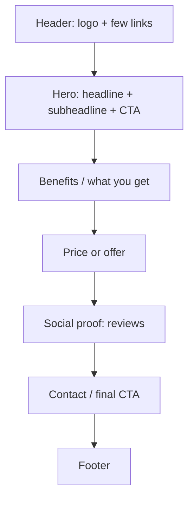

# Session 06: Practice Lab: Styling a Landing Page

> Module: Essentials of Website Design and Development · Diploma in Digital Marketing · Term 1 · ⏱ ~2 hours

A landing page is a single page with one goal: get the visitor to take one action (book, call, buy, sign up). In this lab you will build and style a landing page for a graphic design course in Karachi using an external CSS file, reusable classes and brand colours.

## 🎯 Learning Objectives

- Describe the structure of a high-converting landing page
- Build the page in HTML with meaningful class names
- Style it with an external CSS file organised in sections
- Create a reusable CTA button with a hover effect
- Apply brand colours and readable typography

## 📖 Concepts Explained

### 1. Landing page structure



| Rule | Why |
|---|---|
| One main goal and CTA | Choices distract; one clear action converts better |
| Headline matches the ad | Visitors feel they "landed" in the right place (message match) |
| Benefits before features | People buy outcomes |
| Proof near the CTA | Builds trust at the moment of decision |
| Minimal navigation | Fewer exits |

### 2. Naming classes

Use names that describe **purpose**, not appearance: `.hero`, `.btn`, `.price`, `.site-footer` are better than `.big-blue-box`. If the brand colour changes, the name still makes sense.

### 3. Organising a CSS file

Group rules in sections with comments: base → header → hero → buttons → sections → footer. This makes edits fast, especially when a client asks "change the button colour on every page".

### 4. Colour and typography basics

| Item | Guideline |
|---|---|
| Brand palette | 1 primary, 1 accent (CTA), neutrals (white, greys, near-black) |
| Contrast | Text must be easy to read on its background (check with a contrast checker) |
| Font size | Body 16-18 px, line-height about 1.5-1.6 |
| CTA colour | Stands out from everything else on the page |

## 💻 Code Examples

### Example 1: Landing page HTML (`landing.html`)

```html
<!DOCTYPE html>
<html lang="en">
<head>
  <meta charset="UTF-8">
  <meta name="viewport" content="width=device-width, initial-scale=1">
  <title>Learn Graphic Design in Karachi | Skill Up Academy</title>
  <meta name="description" content="3-month graphic design course in North Nazimabad. Photoshop, Illustrator and Canva with real projects. Book a free demo class.">
  <link rel="stylesheet" href="landing.css">
</head>
<body>
  <header class="site-header">
    <p class="logo">Skill Up Academy</p>
    <nav>
      <a href="#courses">Course</a>
      <a href="#reviews">Reviews</a>
      <a href="#contact">Contact</a>
    </nav>
  </header>

  <section class="hero">
    <h1>Learn Graphic Design in 3 Months</h1>
    <p>Photoshop, Illustrator and Canva with real client projects. Weekend classes in North Nazimabad.</p>
    <a class="btn" href="https://wa.me/923001234567?text=I%20want%20a%20free%20demo%20class">Book a free demo</a>
  </section>

  <section id="courses" class="section">
    <h2>What you will learn</h2>
    <ul class="features">
      <li>Logo and brand identity design</li>
      <li>Social media post and ad design</li>
      <li>Freelancing on Fiverr and Upwork</li>
    </ul>
    <p class="price">Fee: <span class="old">PKR 40,000</span> PKR 30,000 (early bird)</p>
  </section>

  <section id="reviews" class="section alt">
    <h2>What students say</h2>
    <blockquote>"I designed my first paid logo in week six."<br>&mdash; Hamza, Karachi</blockquote>
  </section>

  <section id="contact" class="section">
    <h2>Contact us</h2>
    <p>Call <a href="tel:+923001234567">0300-1234567</a> or <a href="https://wa.me/923001234567">chat on WhatsApp</a>.</p>
  </section>

  <footer class="site-footer">
    <p>&copy; 2026 Skill Up Academy, Karachi</p>
  </footer>
</body>
</html>
```

**How it works:** sections follow the landing-page pattern; nav links jump to sections with anchors; the CTA opens WhatsApp with a pre-filled message; every element has a purposeful class.

### Example 2: Landing page CSS (`landing.css`)

```css
/* ===== Base styles ===== */
* { box-sizing: border-box; }

body {
  margin: 0;
  font-family: "Segoe UI", Arial, sans-serif;
  color: #222;
  line-height: 1.6;
}

/* ===== Header and navigation ===== */
.site-header {
  background: #1e3a5f;
  color: white;
  padding: 12px 20px;
}
.logo { margin: 0; font-weight: bold; font-size: 20px; }
.site-header nav a {
  color: white;
  margin-right: 16px;
  text-decoration: none;
}
.site-header nav a:hover { text-decoration: underline; }

/* ===== Hero section ===== */
.hero {
  background: #f0f6ff;
  text-align: center;
  padding: 60px 20px;
}
.hero h1 { font-size: 34px; margin-top: 0; }

/* ===== Button (reusable class) ===== */
.btn {
  display: inline-block;
  background: #25D366;     /* WhatsApp green */
  color: white;
  padding: 14px 26px;
  border-radius: 8px;
  text-decoration: none;
  font-weight: bold;
}
.btn:hover { background: #1da851; }

/* ===== Content sections ===== */
.section { padding: 40px 20px; max-width: 800px; margin: 0 auto; }
.alt { background: #fafafa; max-width: none; }   /* full-width grey band */
.features li { margin-bottom: 6px; }
.price { font-size: 20px; color: #198754; font-weight: bold; }
.old { text-decoration: line-through; color: #888; }

blockquote {
  border-left: 4px solid #1e3a5f;
  margin: 0 auto;
  max-width: 600px;
  padding-left: 16px;
  font-style: italic;
}

/* ===== Footer ===== */
.site-footer {
  background: #1e3a5f;
  color: white;
  text-align: center;
  padding: 16px;
}
```

**How it works:** the CSS file is grouped into sections. `.btn` is a reusable button with a hover colour; `.section` centres content with a max width; `.alt` creates a full-width grey band for reviews; `.old` strikes through the old price.

## 🧪 Lab Practice

1. Open `landing.html` with Live Server and check every section.
2. Change the brand colours (`#1e3a5f` and `#25D366`) to a new palette from [coolors.co](https://coolors.co) or your brand.
3. Add a "Course schedule" section with its own class and style it.
4. Add a hover effect that slightly lifts the button: `transform: translateY(-2px);` with `transition: 0.2s;`.
5. Run a contrast check on your text colours at [WebAIM Contrast Checker](https://webaim.org/resources/contrastchecker/) and fix any failures.

## 📝 Assignment

Design a landing page for a different offer (for example "Eid Sale: 30% off lawn suits" or "Free solar site survey in Lahore") with header, hero, benefits, offer, reviews, contact and footer, styled with an external CSS file. Submit both files and a screenshot.

## ❓ Quick Quiz

1. What is the main goal of a landing page?
2. What is "message match"?
3. Why name a class `.btn` instead of `.green-box`?
4. What CSS property creates the hover effect timing?
5. Recommended body font size range?

<details>
<summary>Show answers</summary>

1. To get visitors to take one specific action
2. The landing page headline and offer match the ad the visitor clicked
3. Purpose-based names still make sense if the design changes
4. `transition`
5. About 16-18 px

</details>

## 💼 Interview Questions

**1. What makes a landing page convert?**

> One clear goal, a headline that matches the ad, benefit-led copy, trust signals, a visible CTA, fast loading and a mobile-friendly design.

**2. How do you organise CSS for a client site?**

> One external file split into commented sections, purpose-based class names, reusable components like buttons, and consistent brand variables.

**3. Why minimise navigation on landing pages?**

> Every extra link is an exit; fewer distractions keep visitors focused on the CTA.

## ✅ Summary

- Landing pages have one goal and follow a proven section order.
- Use purpose-based class names and a sectioned external CSS file.
- Build a reusable `.btn` with hover feedback.
- Keep colours on-brand, contrast high and text readable.

<!-- nav -->

---

[⬅ Previous](../Session-05-Introduction-to-CSS3/README.md) · [🏠 Module Home](../README.md) · [Next ➡](../Session-07-Formatting-with-Style-Sheets-Box-Model-and-Positioning/README.md)

Prepared by Zeeshan Abbas · Aptech Learning North Nazimabad
