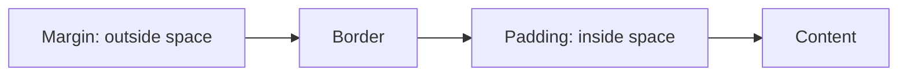

# Session 07: Formatting with Style Sheets: Box Model and Positioning

> Module: Essentials of Website Design and Development · Diploma in Digital Marketing · Term 1 · ⏱ ~2 hours

Now that you can select elements, this session teaches how to make them look and sit exactly where you want: fonts and text styles, inline spans, indentation, borders, alignment and spacing, specificity and pseudo selectors, the box model, and positioning with `position` and `float`. These skills let you build sticky offer bars, floating WhatsApp buttons and discount badges: everyday marketing elements.

## 🎯 Learning Objectives

- Apply font and text properties, including web fonts
- Use `<span>` to style part of a sentence
- Control indentation, borders, horizontal alignment and vertical spacing
- Calculate CSS specificity and use pseudo-classes and pseudo-elements
- Explain the box model and `box-sizing`
- Position elements with relative, absolute, fixed and sticky, and use float

## 📖 Concepts Explained

### 1. Font and text properties

| Property | Example | Effect |
|---|---|---|
| `font-family` | `"Poppins", Arial, sans-serif` | Typeface with fallbacks (a "font stack") |
| `font-size` | `17px`, `1.25rem` | Size (`rem` = relative to root size, good for accessibility) |
| `font-weight` | `400`, `700`, `bold` | Thickness |
| `font-style` | `italic` | Slant |
| `line-height` | `1.6` | Space between lines (vertical spacing inside a paragraph) |
| `letter-spacing` | `1px` | Space between letters |
| `text-transform` | `uppercase` | Change case |
| `text-decoration` | `none`, `underline`, `line-through` | Lines on text |
| `text-shadow` | `1px 1px 2px #999` | Shadow behind text |
| `color` | `#333` | Text colour |

**Web fonts:** Google Fonts provides free fonts via a `<link>` tag; always keep a fallback.

### 2. Inline spans

`<span>` is a neutral inline container. It has no meaning or style by itself, so it is perfect for styling a word or price inside a sentence: `Only <span class="highlight">PKR 999</span> today`.

### 3. Paragraph indentation, borders, alignment and spacing

| Need | Property |
|---|---|
| Indent first line | `text-indent: 40px;` |
| Border | `border: 2px dashed #f0ad4e;` (width, style, colour) |
| Horizontal alignment | `text-align: left / center / right / justify;` |
| Space between lines | `line-height` |
| Space between paragraphs | `margin-top` / `margin-bottom` |

### 4. Specificity

When rules conflict, the more **specific** selector wins. Think of a score **(IDs, classes, elements)**:

| Selector | Score | |
|---|---|---|
| `p` | (0,0,1) | weakest |
| `.message` | (0,1,0) | |
| `p.message` | (0,1,1) | |
| `#welcome` | (1,0,0) | strong |
| inline `style=""` | beats all of the above | |
| `!important` | overrides normal rules (avoid; hard to maintain) | |

If scores are equal, the rule written **later** wins.

### 5. Pseudo selectors

- **Pseudo-classes** (single colon) select a state or position: `:hover`, `:focus`, `:first-child`, `:last-child`, `:nth-child(even)`, `:not(.active)`.
- **Pseudo-elements** (double colon) style part of an element or add content: `::before`, `::after`, `::first-letter`, `::first-line`, `::placeholder`.

### 6. The box model

Every element is a rectangular box:



| Layer | Meaning |
|---|---|
| Content | Text or image, sized by `width`/`height` |
| Padding | Space between content and border; has the background colour |
| Border | Line around the padding |
| Margin | Transparent space outside the border, separating boxes |

By default (`content-box`), `width` is only the content, so padding and border make the box bigger. `box-sizing: border-box` makes `width` include padding and border, which is easier; most developers set it on every element with `* { box-sizing: border-box; }`.

### 7. Positioning and float

| Value | Behaviour | Marketing example |
|---|---|---|
| `static` | Default: normal flow | Regular text |
| `relative` | Shifted from normal place; anchor for absolute children | Product card |
| `absolute` | Placed relative to nearest positioned ancestor | "-20%" badge on a card corner |
| `fixed` | Fixed to the screen, stays while scrolling | Floating WhatsApp/chat button |
| `sticky` | Normal until scrolled, then sticks | Top offer bar, sticky header |

`top`, `right`, `bottom`, `left` set the offset; `z-index` controls which element sits on top.

**Float:** `float: left/right` takes an element out of the normal flow so text wraps around it, like images in a newspaper. Use `clear: both` to stop wrapping. Floats were once used for full layouts; today Flexbox and Grid are preferred (Session 09).

## 💻 Code Examples

### Example 1: Text and font styles (`text-and-font.html`)

```html
<!DOCTYPE html>
<html lang="en">
<head>
  <meta charset="UTF-8">
  <title>Text and Font Styles</title>
  <!-- A free web font from Google Fonts -->
  <link href="https://fonts.googleapis.com/css2?family=Poppins:wght@400;700&display=swap" rel="stylesheet">
  <style>
    body {
      font-family: "Poppins", Arial, sans-serif;  /* font stack: fallback fonts if the first fails */
      font-size: 17px;
      line-height: 1.6;          /* vertical spacing between lines */
      color: #333;
    }
    h1 { font-weight: 700; letter-spacing: 1px; text-transform: uppercase; }
    .lead { font-size: 1.25rem; font-style: italic; }

    /* Paragraph indentation and alignment */
    .indented  { text-indent: 40px; }        /* first line moves right */
    .center    { text-align: center; }
    .justify   { text-align: justify; }
    .right     { text-align: right; }

    /* Vertical spacing between paragraphs */
    .spaced { margin-bottom: 30px; }

    /* Border around a paragraph */
    .note { border: 2px dashed #f0ad4e; padding: 10px; }

    /* Inline span: style part of a sentence */
    .highlight { color: #c0392b; font-weight: 700; }
    .shadow { text-shadow: 1px 1px 2px #999; }
  </style>
</head>
<body>
  <h1 class="shadow">Eid Collection</h1>
  <p class="lead">New lawn prints for summer 2026.</p>
  <p class="indented spaced">This paragraph starts with an indent and has extra space below it.</p>
  <p class="center">Centred text for short announcements.</p>
  <p class="justify">Justified text lines up on both sides. Use it carefully on mobile because it can create uneven gaps between words in narrow columns.</p>
  <p class="right">Right-aligned text.</p>
  <p class="note">Order before <span class="highlight">25th Ramadan</span> for delivery before Eid.</p>
</body>
</html>
```

**How it works:** a Google Font with fallbacks, and one class per text effect: indentation, alignment, spacing, border and a highlighted span.

### Example 2: Box model (`box-model.html`)

```html
<!DOCTYPE html>
<html lang="en">
<head>
  <meta charset="UTF-8">
  <title>The Box Model</title>
  <style>
    .box {
      width: 300px;               /* content width */
      padding: 20px;              /* space INSIDE the border */
      border: 5px solid #1e3a5f;  /* the border line */
      margin: 30px;               /* space OUTSIDE the border */
      background: #e8f0fe;        /* covers content + padding */
    }
    /* Default (content-box): total width = 300 + 20*2 + 5*2 = 350px */

    .box-border {
      box-sizing: border-box;     /* width now INCLUDES padding and border */
    }
    /* With border-box: total width stays exactly 300px */
  </style>
</head>
<body>
  <div class="box">content-box: total width 350px</div>
  <div class="box box-border">border-box: total width 300px</div>
  <p>Open DevTools (F12), select a box and look at the box-model diagram in the Computed tab.</p>
</body>
</html>
```

**How it works:** the same width produces different total sizes depending on `box-sizing`. Inspect both boxes in DevTools to see the diagram.

### Example 3: Specificity and pseudo selectors (`specificity-and-pseudo.html`)

```html
<!DOCTYPE html>
<html lang="en">
<head>
  <meta charset="UTF-8">
  <title>Specificity and Pseudo Selectors</title>
  <style>
    /* Specificity score: (IDs, classes, elements) */
    p            { color: black; }   /* (0,0,1) */
    .message     { color: blue;  }   /* (0,1,0)  beats p */
    #welcome     { color: green; }   /* (1,0,0)  beats .message */
    p.message    { font-weight: bold; } /* (0,1,1) */

    /* Pseudo-classes: style elements in a state or position */
    li:first-child   { font-weight: bold; }
    li:nth-child(even) { background: #f2f2f2; }   /* zebra stripes */
    input:focus      { outline: 2px solid #0d6efd; }
    button:hover     { background: #198754; color: white; }

    /* Pseudo-elements: style part of an element */
    .tip::before     { content: "Tip: "; font-weight: bold; color: #d63384; }
    p.intro::first-letter { font-size: 2em; color: #1e3a5f; }
  </style>
</head>
<body>
  <p id="welcome" class="message">I am green because the ID selector is most specific.</p>
  <p class="message">I am blue (class beats element).</p>
  <p class="intro">Big first letter using ::first-letter.</p>

  <ul>
    <li>First item (bold)</li>
    <li>Second item (striped)</li>
    <li>Third item</li>
    <li>Fourth item (striped)</li>
  </ul>

  <p class="tip">Write one H1 per page.</p>
  <input type="text" placeholder="Click me to see focus">
  <button>Hover me</button>
</body>
</html>
```

**How it works:** the comments show each selector's specificity; pseudo-classes create zebra stripes and focus/hover states; pseudo-elements add a "Tip:" label and a large first letter.

### Example 4: Positioning and float (`position-and-float.html`)

```html
<!DOCTYPE html>
<html lang="en">
<head>
  <meta charset="UTF-8">
  <title>Positioning and Float</title>
  <style>
    body { font-family: Arial, sans-serif; margin: 0; padding-bottom: 80px; }

    /* 1. relative: moves from its normal place; also acts as anchor for absolute children */
    .card { position: relative; width: 260px; padding: 20px; margin: 20px; border: 1px solid #ccc; }

    /* 2. absolute: placed relative to the nearest positioned parent (.card) */
    .badge { position: absolute; top: -10px; right: -10px; background: #dc3545; color: #fff; padding: 4px 8px; border-radius: 4px; }

    /* 3. fixed: stays on screen while scrolling (e.g. WhatsApp button) */
    .whatsapp { position: fixed; bottom: 16px; right: 16px; background: #25D366; color: #fff; padding: 12px 16px; border-radius: 30px; text-decoration: none; }

    /* 4. sticky: normal until you scroll past it, then sticks to the top */
    .topbar { position: sticky; top: 0; background: #1e3a5f; color: #fff; padding: 10px; }

    /* 5. float: text wraps around the image */
    .thumb { float: left; width: 120px; height: 90px; background: #ddd; margin: 0 12px 8px 0; }
    .clear { clear: both; }   /* stop wrapping after the float */
  </style>
</head>
<body>
  <div class="topbar">Free delivery on orders above PKR 3,000</div>

  <div class="card">
    <span class="badge">-20%</span>
    <h3>Lawn 3-Piece</h3>
    <p>PKR 4,800</p>
  </div>

  <div style="margin: 20px;">
    <div class="thumb"></div>
    <p>This text wraps around the grey image box because the box is floated left. Floats were once used for whole layouts; today we use Flexbox and Grid for layouts and keep float mainly for wrapping text around images.</p>
    <p class="clear">This paragraph starts below the image because of clear: both.</p>
  </div>

  <div style="height: 900px; margin: 20px;">Scroll down: the top bar sticks and the WhatsApp button stays fixed.</div>

  <a class="whatsapp" href="https://wa.me/923001234567">WhatsApp</a>
</body>
</html>
```

**How it works:** a sticky offer bar, a relative card with an absolute badge, a fixed WhatsApp button and a float that wraps text.

## 🧪 Lab Practice

1. Change the font in `text-and-font.html` to another Google Font and adjust line-height to 1.8. Compare readability.
2. In `box-model.html`, change padding to 40px and calculate the new total width for both boxes before checking in DevTools.
3. Add a rule to `specificity-and-pseudo.html` that makes the green paragraph red **without** editing the ID rule. (Hint: higher specificity or later rule with equal specificity.)
4. Move the badge in `position-and-float.html` to the top-left corner.
5. Add a `::after` pseudo-element that adds " →" to every link.

## 📝 Assignment

Create a product page section for an online shop: a sticky top offer bar, a product card with an absolute "New" badge, an image floated left with description text wrapping, a highlighted price using a span, and a fixed WhatsApp button. Use one external CSS file.

## ❓ Quick Quiz

1. Which selector wins: `.price` or `#main-price`?
2. What does `box-sizing: border-box` change?
3. Which position value keeps a button on screen while scrolling?
4. What is the difference between `:hover` and `::before`?
5. Which property stops text wrapping around a float?

<details>
<summary>Show answers</summary>

1. `#main-price` (ID is more specific)
2. Width and height include padding and border
3. `fixed`
4. `:hover` is a pseudo-class (state); `::before` is a pseudo-element (adds content before an element)
5. `clear`

</details>

## 💼 Interview Questions

**1. Explain the box model.**

> Each element is a box of content, padding, border and margin. Its total size depends on these layers and on `box-sizing`.

**2. Why avoid `!important`?**

> It breaks the normal cascade, makes debugging hard and leads to more `!important` rules to override it.

**3. How would you add a floating WhatsApp button?**

> A link with `position: fixed; bottom: 16px; right: 16px;`, a contrasting background, rounded corners and a `z-index` above other content.

## ✅ Summary

- Font and text properties control typography; always add fallback fonts.
- `<span>` styles part of a line; borders, indents and spacing refine paragraphs.
- Specificity order: inline > ID > class > element; later rules win ties.
- Pseudo-classes target states; pseudo-elements target parts.
- Box model: content, padding, border, margin; prefer `border-box`.
- Position: relative, absolute, fixed, sticky; float wraps text around images.

<!-- nav -->

---

[⬅ Previous](../Session-06-Practice-Lab-Styling-a-Landing-Page/README.md) · [🏠 Module Home](../README.md) · [Next ➡](../Session-08-Practice-Lab-Pricing-Cards-and-Page-Layout/README.md)

Prepared by Zeeshan Abbas · Aptech Learning North Nazimabad
