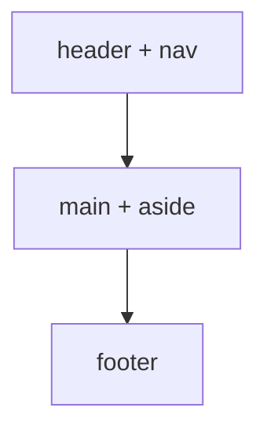

# Session 09: HTML Layout, Forms and Media Elements

> Module: Essentials of Website Design and Development · Diploma in Digital Marketing · Term 1 · ⏱ ~2 hours

Lead forms collect enquiries, videos tell brand stories, and a clean responsive layout keeps mobile visitors from leaving. This session covers HTML5 semantic layout elements, modern layout with Flexbox and media queries, HTML5 forms and input types, and media elements: images with captions, video, audio and embeds (YouTube and Google Maps).

## 🎯 Learning Objectives

- Structure pages with semantic elements: header, nav, main, article, section, aside, footer
- Build responsive layouts with Flexbox and media queries
- Create HTML5 forms with labels, input types, select, radio, checkbox and textarea
- Use built-in validation: required, pattern, type
- Add images, figure/figcaption, video, audio and iframes responsively
- Explain why forms and media matter for conversion and SEO

## 📖 Concepts Explained

### 1. Semantic layout elements

| Element | Meaning |
|---|---|
| `<header>` | Intro area: logo, title, nav |
| `<nav>` | Main navigation links |
| `<main>` | The unique main content (once per page) |
| `<article>` | Self-contained content: blog post, product, news item |
| `<section>` | A themed group of content with a heading |
| `<aside>` | Related side content: sidebar, ads, related posts |
| `<footer>` | Closing info: copyright, contacts, links |
| `<time>` | A date/time machine-readable via `datetime` |

Semantic tags help screen readers, make code readable and give search engines clearer structure. `<div>` is still fine for pure styling wrappers.



### 2. Flexbox basics

`display: flex` on a parent arranges its children in a row (or column).

| Property (on parent) | Use |
|---|---|
| `flex-direction: row / column` | Direction |
| `justify-content: space-between / center` | Spacing along the main axis |
| `align-items: center` | Alignment across |
| `gap: 20px` | Space between children |
| `flex-wrap: wrap` | Allow items to move to the next line |

On children, `flex: 1` shares space equally; `flex: 3` vs `flex: 1` gives a 3:1 split.

### 3. Responsive design with media queries

```css
@media (max-width: 768px) {
  .layout { flex-direction: column; }
}
```

Mobile-first approach: write styles for phones first, then add `min-width` media queries for bigger screens. Always include the viewport meta tag.

### 4. HTML5 forms

| Part | Purpose |
|---|---|
| `<form action method>` | Where and how data is sent (`post` for forms with personal data) |
| `<label for="id">` | Accessible name; clicking it focuses the field |
| `name` attribute | The key used when data is sent |
| `required` | Field must be filled |
| `placeholder` | Hint text (not a replacement for a label) |
| `pattern` | Regular expression check, e.g. `03[0-9]{9}` |

**Input types:** `text`, `email`, `tel`, `number`, `date`, `password`, `url`, `checkbox`, `radio`, `range`, `file`, `submit`. On phones, `email` and `tel` show the right keyboard, which reduces typing errors and drop-offs.

**Form conversion tips:** ask only what you need (name + phone often enough), one column, big tap targets, clear button text ("Book my demo" beats "Submit"), a consent checkbox when you will contact people, and a thank-you message.

### 5. Media elements

| Element | Key attributes |
|---|---|
| `` | `src`, `alt`, `width`, `height` (prevents layout shift), `loading="lazy"` |
| `<figure>` + `<figcaption>` | Image or chart with caption |
| `<video>` | `controls`, `poster`, `<source type="video/mp4">`, `muted autoplay playsinline` for silent background videos |
| `<audio>` | `controls`, `<source type="audio/mpeg">` |
| `<iframe>` | Embed YouTube, Google Maps; add `title` and `loading="lazy"` |

Make media responsive with `max-width: 100%; height: auto;` and `aspect-ratio: 16 / 9` for embeds.

## 💻 Code Examples

### Example 1: Semantic layout with Flexbox (`semantic-layout.html`)

```html
<!DOCTYPE html>
<html lang="en">
<head>
  <meta charset="UTF-8">
  <meta name="viewport" content="width=device-width, initial-scale=1">
  <title>Semantic Layout with Flexbox</title>
  <style>
    * { box-sizing: border-box; }
    body { margin: 0; font-family: Arial, sans-serif; }
    header, footer { background: #1e3a5f; color: #fff; padding: 14px 20px; }

    /* Flexbox: put nav links in a row with space between */
    nav ul { display: flex; gap: 16px; list-style: none; margin: 0; padding: 0; }
    nav a { color: #fff; text-decoration: none; }

    /* Main area: article and aside side by side */
    .layout { display: flex; gap: 20px; padding: 20px; }
    main { flex: 3; }          /* takes 3 parts of the space */
    aside { flex: 1; background: #f2f2f2; padding: 12px; }   /* takes 1 part */

    /* On phones, stack main and aside */
    @media (max-width: 700px) {
      .layout { flex-direction: column; }
    }
  </style>
</head>
<body>
  <header>
    <strong>Karachi Food Blog</strong>
    <nav>
      <ul>
        <li><a href="#">Home</a></li>
        <li><a href="#">Reviews</a></li>
        <li><a href="#">Contact</a></li>
      </ul>
    </nav>
  </header>

  <div class="layout">
    <main>
      <article>
        <h1>Best Nihari Spots in Karachi</h1>
        <p>Published <time datetime="2026-10-20">20 October 2026</time></p>
        <section>
          <h2>1. Burns Road</h2>
          <p>Classic, rich and spicy.</p>
        </section>
        <section>
          <h2>2. Federal B Area</h2>
          <p>Great for families.</p>
        </section>
      </article>
    </main>

    <aside>
      <h3>Popular posts</h3>
      <p>Top 5 biryani places</p>
    </aside>
  </div>

  <footer>&copy; 2026 Karachi Food Blog</footer>
</body>
</html>
```

**How it works:** semantic tags structure the page; Flexbox arranges the nav links in a row and the main/aside in a 3:1 split; the media query stacks them on phones.

### Example 2: HTML5 lead form (`lead-form.html`)

```html
<!DOCTYPE html>
<html lang="en">
<head>
  <meta charset="UTF-8">
  <meta name="viewport" content="width=device-width, initial-scale=1">
  <title>HTML5 Lead Form</title>
  <style>
    form { max-width: 420px; font-family: Arial, sans-serif; }
    label { display: block; margin-top: 12px; font-weight: bold; }
    input, select, textarea { width: 100%; padding: 10px; margin-top: 4px; font-size: 16px; }
    button { margin-top: 16px; padding: 12px 20px; background: #198754; color: #fff; border: 0; font-size: 16px; }
  </style>
</head>
<body>
  <h1>Book a Free Demo Class</h1>

  <!-- action = where data is sent; method = how (post hides data from the URL) -->
  <form action="https://example.com/submit" method="post">

    <!-- label "for" matches input "id": clicking the label focuses the input -->
    <label for="name">Full name</label>
    <input type="text" id="name" name="name" placeholder="e.g. Ali Raza" required>

    <!-- type="email" checks the format and shows an email keyboard on phones -->
    <label for="email">Email</label>
    <input type="email" id="email" name="email" placeholder="you@example.com" required>

    <!-- type="tel" opens the number keypad; pattern checks a Pakistani mobile format -->
    <label for="phone">Mobile number</label>
    <input type="tel" id="phone" name="phone" placeholder="03001234567" pattern="03[0-9]{9}" required>

    <!-- Drop-down list -->
    <label for="course">Course</label>
    <select id="course" name="course">
      <option value="seo">SEO</option>
      <option value="smm">Social Media Marketing</option>
      <option value="ads">Google Ads</option>
    </select>

    <!-- Radio buttons: choose ONE (same name) -->
    <p><strong>Preferred time</strong></p>
    <label><input type="radio" name="time" value="weekday" checked> Weekdays</label>
    <label><input type="radio" name="time" value="weekend"> Weekends</label>

    <!-- Date picker -->
    <label for="date">Demo date</label>
    <input type="date" id="date" name="date">

    <!-- Multi-line text -->
    <label for="msg">Message (optional)</label>
    <textarea id="msg" name="message" rows="3"></textarea>

    <!-- Checkbox for consent -->
    <label><input type="checkbox" name="consent" required> I agree to be contacted on WhatsApp</label>

    <button type="submit">Book my demo</button>
  </form>
</body>
</html>
```

**How it works:** each field has a label; input types give the right mobile keyboard; `required` and `pattern` block bad data before submission; radio buttons share a `name` so only one can be chosen.

### Example 3: Media elements (`media-elements.html`)

```html
<!DOCTYPE html>
<html lang="en">
<head>
  <meta charset="UTF-8">
  <meta name="viewport" content="width=device-width, initial-scale=1">
  <title>HTML5 Media Elements</title>
  <style>
    img, video, iframe { max-width: 100%; height: auto; }   /* never wider than the screen */
    .video-wrap iframe { aspect-ratio: 16 / 9; width: 100%; height: auto; }
  </style>
</head>
<body>
  <h1>Media Elements</h1>

  <!-- 1. Image with caption -->
  <figure>
    
    <figcaption>Summer lawn collection 2026</figcaption>
  </figure>

  <!-- 2. Video with controls and a poster image -->
  <video controls width="640" poster="video-poster.jpg">
    <source src="promo.mp4" type="video/mp4">
    Your browser does not support the video tag.
  </video>

  <!-- 3. Audio (e.g. a podcast clip) -->
  <audio controls>
    <source src="podcast-clip.mp3" type="audio/mpeg">
    Your browser does not support the audio element.
  </audio>

  <!-- 4. Embedded YouTube video (replace VIDEO_ID with a real ID) -->
  <div class="video-wrap">
    <iframe src="https://www.youtube.com/embed/VIDEO_ID" title="Promo video" allowfullscreen loading="lazy"></iframe>
  </div>

  <!-- 5. Embedded Google Map (replace with the embed link from Google Maps > Share > Embed) -->
  <iframe src="https://www.google.com/maps?q=North+Nazimabad+Karachi&output=embed" width="600" height="300" title="Map to our office" loading="lazy"></iframe>
</body>
</html>
```

**How it works:** images and embeds scale to the screen; `loading="lazy"` delays off-screen media for speed; `figure` adds a caption; video and audio have built-in controls and fallback text.

## 🧪 Lab Practice

1. Convert the mini-site from Session 04 to semantic elements (header, nav, main, footer).
2. Add `justify-content: space-between` to the header in `semantic-layout.html` so the logo and nav sit at opposite ends.
3. Add an "Age" field (`type="number"`, min 16, max 60) and a "City" drop-down to the lead form.
4. Test the form: submit with an invalid phone and note the browser message.
5. Replace `VIDEO_ID` with a real YouTube video ID and embed a Google Map of your area.

## 📝 Assignment

Build a "Contact Us" page for a clinic with semantic layout, a two-column Flexbox layout (form on one side, map and address on the other) that stacks on mobile, a booking form with at least six input types and validation, and an embedded map.

## ❓ Quick Quiz

1. Which element should appear only once and hold the main content?
2. Which input type shows a numeric keypad for phone numbers?
3. What does `flex: 3` on main and `flex: 1` on aside do?
4. Why add `width` and `height` to images?
5. What attribute groups radio buttons so only one can be selected?

<details>
<summary>Show answers</summary>

1. `<main>`
2. `type="tel"`
3. Main takes three parts of the space and aside one part (3:1)
4. To reserve space and prevent layout shift (CLS)
5. The same `name` attribute

</details>

## 💼 Interview Questions

**1. How do you increase form conversion rates?**

> Reduce fields, use correct input types, clear labels and button text, show trust signals near the form, make it mobile-friendly and confirm submission clearly.

**2. Why use semantic HTML?**

> It improves accessibility, readability and maintainability, and helps search engines understand page structure.

**3. What is mobile-first design?**

> Designing for small screens first, then enhancing the layout for larger screens with min-width media queries.

## ✅ Summary

- Semantic elements give pages meaningful structure.
- Flexbox and media queries create responsive layouts.
- HTML5 forms offer input types and built-in validation; fewer fields convert better.
- Media elements (img, figure, video, audio, iframe) should be responsive and lazy-loaded.

<!-- nav -->

---

[⬅ Previous](../Session-08-Practice-Lab-Pricing-Cards-and-Page-Layout/README.md) · [🏠 Module Home](../README.md) · [Next ➡](../Session-10-Practice-Lab-Responsive-Landing-Page-with-Lead-Form/README.md)

Prepared by Zeeshan Abbas · Aptech Learning North Nazimabad
